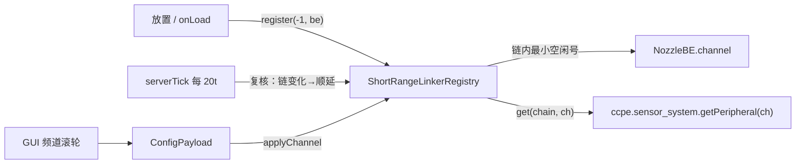

# 矢量喷管 `ccpe:advanced_thrust_nozzle` 工作记录

> 状态（2026-11，**v9 定稿，功能基本齐全**）：可转动模型 + 四活塞随动 ✅、频道 + 右键 GUI ✅、
> CC:T 外设（偏转 / 出力）✅、**偏转点直线插值 + `setDirection` 摇杆写法** ✅（用户实测"完全符合预期"）；
> `./gradlew.bat classes` 通过。
> 现行两个手感参数：**偏转平面线速度 160°/s**、**矢量喷管出力 2 pN/RPM**（定向喷管仍 1 pN/RPM）。
> 本轮（2026-11）变更明细见 §11；**第二轮（用户重做模型 + 选择框改两盒 + 活塞杆改"body 子件只滑动"）见 §12**，
> 那轮的几何数字（枢轴 `y2`、夹持高度 `y5`、活塞头并进 `base.json`、v5 活塞机构）**待用户进游戏实测确认**。
> ⚠️ 换模型后若动画错位，先对 §12.4 那张"模型数字 ↔ 代码常量"表。
>
> 七个能力一句话版：
> 1. **可倾斜喷口**：固定底板 + 绕枢轴 `(8,2,8)px` 在**锥角 15° 内**任意指向的喷口本体；
> 2. **四活塞随动**：活塞头固定（0 自由度，**已并进底座模型**）、活塞杆是 **body 的子件、只沿 body 轴伸缩**（1 自由度，§4）；
> 3. **推力 = 倾斜轴**：`nozzleAxis()` 钩子让推力与**全部粒子链路**一起跟着倾斜轴走；
> 4. **出力系数**：Lua `setThrustScale(0..1)` 乘在「风扇转速 × 气压」之上（默认 1.0）；**矢量喷管满出力 = 2 pN/RPM**；
> 5. **物理体作用域频道**：放置自动分配、只在物理体上生效、与 `short_range_linker` / 控制台共享频道空间；
> 6. **CC:T 外设**：`setDeflection(方位角, 锥角)`（极坐标）/ `setDirection(x, y)`（摇杆，`-1..1`）/ `getDeflection` /
>    `getMaxTilt` / `isMoving` / `setThrustScale` / `getThrustScale` / `getChannel`，可用 `ccpe.sensor_system.getPeripheral(ch)` 寻址。
> 7. **渐变到位**：Lua 只写目标，服务端**恒速**推进、客户端本地指数逼近平滑（§6.5），插值发生在**偏转平面**上 ⇒ 轴端走**直线**。
>
> 母文档：`memo/thrust-nozzle.md`（定向喷管 `ccpe:thrust_nozzle` 本体；本方块**继承**它的一切）。

---

## 1. 需求与决策链（用户定稿）

| 议题 | 结论 |
|---|---|
| 参考对象 | `aeronautics:gyroscopic_propeller_bearing`（固定体 + 可倾盘 + 四个动态小活塞） |
| 与参考的差别 | 参考是"**固定体在下、可动盘在上**"；本方块是"**固定底板在下、可动 block 在上**"，**活塞上下镜像** ⇒ 自由度必须重算（§4） |
| 固定/可动划分 | 固定 = 底板 `base.json`（**含 4 个活塞头**）；可动 = `block.json`（裙边 + 筒身 + 十字臂 + 顶环），绕枢轴 `(8,2,8)px` |
| 推力方向 | **倾斜后的轴向**（锥内任意方向，矢量引擎语义） |
| 锥角钳位 | **15°**（几何依据见 §6.3） |
| 角度 API 形态 | 两种写法并存：极坐标 `setDeflection(方位角, 锥角)` + 摇杆 `setDirection(x, y)`（`-1..1`，方向=方位、长度=锥角），另给 `getDeflection` / `getMaxTilt` |
| 状态表示 | **偏转点 `(x, y)`**（长度=锥角、方向=方位）才是状态，方位/锥角只是它的极坐标读法；插值在偏转平面上做 ⇒ **走直线**（用户定稿） |
| 出力 API | `setThrustScale(0..1)` 乘在「转速 × 气压」上，默认 **1.0**；**矢量喷管满出力 = 2 pN/RPM**（`THRUST_OUTPUT_MULTIPLIER = 2.0`，2026-11 用户定稿；定向喷管仍 1 pN/RPM） |
| 选择框/碰撞箱 | **底板 `(0,0,0,16,4,16)` + 喷口包络 `(2,4,2,14,16,14)`** 两个盒（2026-11 用户定稿；**不随倾斜/动画改变**，六向由模型旋转生成） |
| GUI 内容 | **只有频道滚轮**，不做"加载物理体"开关（喷嘴不持有 force-load ticket） |
| 频道作用域 | 物理体（含约束链）；非物理体**不注册** |
| 外设方法 | 本阶段提供偏转 + 出力 + `getChannel`（早期一版曾定"暂不给 getChannel"，最终按外设形态给回） |
| 偏转是否瞬间到位 | **否**：Lua 只写目标，服务端**恒速**推进（§6.5），客户端用同一速度的墙钟纯函数画 |
| 渐变参数 | **写死在代码里**（偏转平面线速度 160°/s = 8°/tick、出力 0.25/tick），Lua 不提供速度/时长参数 |
| 平滑算法 | 视觉偏转点 = **一个朝 target 走的点**，每次渲染用 `System.nanoTime` **差值**推进一步（§6.5 v9）；**不要**改回"每 tick 累加 / 按调用频率推进 / (起点,终点,起始时刻) 三元组" |
| 方位角跨 0/360 | 不再有"最短路径"逻辑：目标是**偏转平面上的点**，走直线；穿过中心时方位瞬间反向属正常（§6.3 第 3 条） |
| `getDeflection` 返回 | **实际角 + 目标角都给**，另加 `isMoving()` |
| 出力系数是否渐变 | **是**，与角度同一套曲线（数值单位改成"系数/秒"） |

---

## 2. 结构与模型

模型目录 `src/main/resources/assets/ccpe/models/block/advanced_thrust_nozzle/`（用户自建 Blockbench 模型）：

| 文件 | 内容 | 用途 |
|---|---|---|
| `base.json` | 底板 `x0..16, y0..4, z0..16` + **4 个活塞头**（半径 6..8px、`y4..6`、切向 6px，坐在底板上表面） | **固定件**，走 blockstate 静态渲染 |
| `block.json` | 裙边 `y2..6`、筒身 `y6..14`、四条十字臂 `y9..13`（伸到方块四边）、顶环 `y14..18` | **可动部分**，走 BER 动态渲染 |
| ~~`piston_head.json`~~ | **已删除**（2026-11：头是固定件、与底座无相对移动 ⇒ 并进 `base.json`） | — |
| `piston_pole.json` | 1×7×2px 连杆（`from [-0.5,0,-1] to [0.5,7,1]`，局部原点 = 铰点） | 4 个活塞杆（可动件） |
| `item.json` | 上面全部 + `groups` 静态摆位 | 物品模型；**group 的摆位是几何基准的权威来源** |

**几何基准（从 `item.json` 反推，单位 px）**——2026-11 用户重做模型后：

| 部件 | 距中轴 | 高度 | 切向宽 |
|---|---|---|---|
| 底板 | 0..8（整块） | **0..4** | 16 |
| 活塞头 | **6..8** | **4..6** | 6 |
| 活塞杆 | **6..7** | **5..12** | 2 |
| 枢轴 | — | **y=2**（底板中面 = 裙边下沿）、x/z=8 | — |

⇒ **铰点 = 杆底面中心 = 距中轴 6.5px、高度 y=5px**（§4.3 的模型定位约定就用这个点）。
杆底面插进活塞头 1px（5 在 4..6 之间），绕铰点摆动时接缝始终被头挡住。

> ⚠️ 旧版几何（底板 y0..2、头 y0..2、杆 y1..8、枢轴 y1）已被这一版取代；`piston_pole.json` 本身<b>没变</b>
> （定位靠"局部原点 = 铰点"的约定，改高度只改代码里的 `PISTON_HINGE_HEIGHT`）。

---

## 3. 渲染（`AdvancedThrustNozzleRenderer`）

### 3.1 只走 BER，不注册 Flywheel Visual

照 `MyBearingPlateRenderer` 的先例：**没有 Visual 时 Flywheel 不会跳过原版 BE 渲染**，所以 BER 是唯一渲染来源。
⚠️ 因此渲染器里**不能**加 `VisualizationManager.supportsVisualization(...)` 提前返回，否则装 Flywheel 就整个消失。

### 3.2 变换链（外 → 内）

```
FACING 旋转（与 blockstate 的 x/y 旋转严格一致）
  → 绕枢轴倾斜 rotateAround(tilt, PIVOT)          // = translate(+P)·rotate·translate(−P)
  → 各部件自身平移 / 方位旋转
```

- **FACING 链逐步照抄已验证的 `ServoBearingRenderer`**：
  水平朝向先 `rotateCentered(rad(horizontalAngle(反朝向)), UP)`，再
  `rotateCentered(rad(-90 - verticalAngle), EAST)`——它与本方块 blockstate 的
  up/down(x180)/north(x90)/east·south·west(x90+y90·180·270) 六变体逐条对应。
- ⚠️ **`SuperByteBuffer` 的变换是"先调用 = 外层"**（内部 `PoseStack` 累乘 + `renderInto` 末尾自动 `reset()`，
  所以同一个 partial 在一个循环里画 4 次也不会累积变换）。外层必须先调用，部件平移最后调用。
- 枢轴 `PIVOT = (8,2,8)px = (0.5, 2/16, 0.5)`（底板 y0..4 的中面；裙边下沿 y2 也正好在这一层，倾斜时裙边下沉量 6px·sin15° ≈ 1.6px 刚好埋进底板，不露出方块底面）。

### 3.3 倾斜姿态来源

`AdvancedThrustNozzleBlockEntity#getRenderTiltQuaternion(float frameTicks)`：把模型空间 `+Y` 转到 `tiltDirModel()`
（由方位角 / 锥角派生）的**最小弧**四元数。渲染版先把服务端同步来的当前角经
`JoystickTilt#approach`（指数逼近、帧时间修正）平滑到本地动画状态，再合成四元数（§6.5）。
物理侧 `nozzleAxis()` 用同一个方向的**当前值**再按 blockstate 旋转转到 plot 系 ⇒ **推力方向与视觉方向一致**。

---

## 4. 活塞机构（自由度，**前后写错过三版，最终版在这里**）

### 4.1 最终机构（v5，2026-11 第二轮；用户实测方向见 §9）

| 部件 | 隶属 | 自由度 | 实现 |
|---|---|---|---|
| 活塞头 | **底座（固定件）** | **0** | **不写代码**：已并进 `base.json`，由 blockstate 静态模型渲染（`y4..6`、半径 6..8px） |
| 活塞杆 | **body 的子件** | **1（沿 body 自身 +Y 的滑动）** | `AdvancedThrustNozzleRenderer`：`rotateAround(tilt, PIVOT) + translate(径向钉死 + 滑移) + rotateY(azimuth)` —— **与 body 同一个 tilt、同一个枢轴** ⇒ 相对 body **无旋转**，只在臂槽里伸缩 |

视觉结果 = **固定的头 + 在 body 臂槽里伸缩的杆 + 随倾斜滑过杆顶的 body**。

**为什么必须是"body 的子件"**（v5 的核心，别再改回去）：
v3/v4 是"杆底面钉死在铰点、绕铰点吃 tilt"。两者朝向确实永远平行（相对旋转 = 0），但**旋转中心不同**
（杆绕铰点、body 绕枢轴）⇒ 相对位移 = `(I − R)(H − P)`，其中 `H − P = (6.5, 3, 0)px`：
15° 时**横向最多 ≈1px、轴向最多 ≈1.8px**。杆径向只有 1px 粗、臂槽每边只有 1px 余量 ⇒
那 1px 横向会让杆蹭出 body 侧壁、扎进臂槽边缘，"看起来像杆在乱飘"（用户 2026-11 实测反馈）。
改成 body 子件后横向恒为 0（径向钉死在槽心），**剩下的全部误差都被"轴向滑动"吃掉**。

**滑移量怎么来**（`pistonSlideAlongBodyAxis`）：反过来解——让**杆底面在世界/底座坐标系里的高度恒为
`PISTON_HINGE_HEIGHT`（活塞头夹持那一层）**：

```
slide = (PISTON_HINGE_HEIGHT − PIVOT.y − (R·radial).y) / (R·ŷ).y
```

展开出来的就是 `(R·radial).y = ±6.5px·sin15° ≈ ±1.68px` 的补偿项。它与参考实现
`GyroscopicPropellerBearingRenderer` 第 77 行 `translateDistance = p·n_tilted / (n_fixed·n_tilted)`
是**同一个公式的镜像**（那边沿固定轴把活塞"卡"在倾斜盘上，这边沿 body 轴把杆"卡"在固定活塞头上）。

**实测数值（px，`item.json` 静止姿态为基准）**

| 倾斜 | 滑移 | 杆底(世界)y | 杆顶(body 系)y |
|---|---|---|---|
| 0° | 3.00 | 5.00（与模型完全一致） | 12.00 |
| 朝本活塞 +15° | 4.00（被 §4.1 的夹取生效，未夹时 4.85） | 4.18（仍在头 y4..6 里） | 13.00 |
| 背本活塞 −15° | 1.36 | 5.00 | 10.36 |

⇒ **两个硬边界永远成立**：杆底 ∈ [4.18, 5]px（活塞头 y4..6）、杆顶 ≤ 13px（十字臂带上沿）。
> 夹取的必要性：不夹时朝本活塞一侧滑移达 4.85px，杆顶会超出臂带上沿 0.85px 露一截（臂带上沿 y13、
> 杆长 7px、枢轴 y2 ⇒ 上限 = 13−2−7 = 4px）。夹取只牺牲那一侧的 0.8px 夹持高度（藏在头里面）。

### 4.2 三版错误（别再犯）

| 版本 | 做法 | 为什么错 |
|---|---|---|
| v1 | 照参考"头贴倾斜面升降、杆保持竖直" | 参考是"头顶在转盘上、杆朝下插进固定体"，本方块**上下镜像**，头在那个高度只能是固定件 |
| v2 | 头固定 + 杆沿自身轴**滑动**（`s = r·(N·d) + h0·(cosθ−1)`） | 滑动方向对了一半，但**滑移量的约束给错了**（v5 才是对的那条约束：卡在固定活塞头上，见 §4.1） |
| v3 | 头 0 自由度 + 杆**绕铰点转动** | 朝向正确、机构也像，但相对 body 混进 ≈1px 横向位移（旋转中心不同）⇒ 杆蹭出 body 侧壁（2026-11 用户实测） |
| v4 | 头并进 `base.json`（连渲染都不用了） | 头本来就钉在底板上、与底座没有相对移动 ⇒ 单独一个 partial 纯属多余；`piston_head.json` 已删 |
| v5 ✅ | 头固定 + 杆 = **body 子件、只沿 body 轴滑动**（滑移量由"杆底卡在夹持高度"反解 + 顶部夹取） | 相对 body 只剩上下位移，横向恒 0 |

### 4.3 模型定位约定：**局部原点 = 杆底面中心、局部 +X = 径向朝外**

| 模型 | 目标坐标 | 含义 |
|---|---|---|
| `piston_pole.json` | `from [-0.5, 0, -1] to [0.5, 7, 1]` | 底面中心 = 原点，杆沿 **+Y** 向上 7px；径向 1px(X)、切向 2px(Z)；**局部 +X = 径向朝外** |

对应代码常量（都是 px/16）：径向位置 `PISTON_HINGE_RADIUS = 6.5/16`、静止夹持高度
`PISTON_HINGE_HEIGHT = 5/16`、杆长 `PISTON_LENGTH = 7/16`（只用于顶部夹取）、
臂带上沿 `PISTON_TOP_LIMIT = 13/16`。

> 改动模型时**只改 `from`/`to`**，UV 与尺寸不变；若在 Blockbench 里重新导出，必须保持这个坐标，
> 否则会退回旧定位（游戏读的是导出的 json）。换位置/换长度时**改上面那四个常量**，不要给模型加偏移。

---

## 5. 频道 + 右键 GUI

### 5.1 直接复用 `ShortRangeLinkerRegistry`（不新造注册表）

关键发现：`compat/cc/ShortRangeLinkerRegistry` 本来就是"物理体作用域频道表"
（`子次元UUID → (频道 → BlockEntity)`），而且**控制台早就和链接器共用它**。

| 能力 | 现成实现 |
|---|---|
| 放置自动分配（链内最小空闲） | `register(desired < 0, be)` |
| 同链冲突顺延 | 同上（返回实际频道） |
| **非物理体不注册** | 同上（返回 `-1`）⇒ 正好是"只在物理体上生效" |
| 按链查询 / 占用快照 / 注销 | `get(chainUuids, ch)` / `occupiedChannels(...)` / `unregisterAll(be)` |

频道号语义 = **喷嘴在物理体内的地址**（同链 1:1），与链接器/控制台共享同一频道空间。

### 5.2 生命周期

- `onLoad` → 注册；`setRemoved` → 注销；
- **`serverTick` 每 20 tick 复核**（轴承连/断后约束链变化 ⇒ 频道空间合并/拆分，同链冲突要顺延）；
- 离开物理体（拆到地上）⇒ `channel` 复位 `-1`，重新装上再自动分配；
- GUI 改动走 `AdvancedThrustNozzleConfigPayload` → 服务端 `applyChannel(desired)`（顺延回写 + 广播占用快照）。

数据流：



### 5.3 文件

| 文件 | 内容 |
|---|---|
| `screen/AdvancedThrustNozzleMenu.java` | 照 `ShortRangeLinkerMenu`，**去掉 bodyLoad**：pos / onPhysicsBody / channel / occupiedChannels |
| `screen/AdvancedThrustNozzleScreen.java` | 照 `ShortRangeLinkerScreen`：频道滚轮（跳过同链占用 + Shift ×10）+ 非物理体提示 + tooltip 前景层 + 完成按钮；背景**复用** `textures/gui/gui_link.png` |
| `network/AdvancedThrustNozzleConfigPayload.java` / `…PacketHandlers.java` | pos + channel；服务端二次校验"非物理体忽略"→ `applyChannel` → 刷新占用快照 |

### 5.4 状态与坑

- `onPhysicsBody` **不落盘、也不进 update tag**：客户端以 `channel >= 0` 推断。
- **蓝图部署后频道会重新分配**：父类 `ThrustNozzleBlockEntity` 没实现 `SafeNbt.writeSafe`，本轮未补
  （喷嘴的频道是"地址"，重分配可接受）。要持久化就给 BE 补 `writeSafe`/`readSafe`。
- 打开 GUI 前必须 `refreshOccupiedChannels()`，否则滚轮跳过的是旧占用。

---

## 6. CC:T 外设（偏转 + 出力）

### 6.1 Lua API（type = `advanced_thrust_nozzle`）

| 方法 | 语义 |
|---|---|
| `setDeflection(azimuthDeg, tiltDeg)` → bool | **极坐标写法**：方位角绕 FACING 轴（0..360，负值自动归正）、锥角自动钳到 `0..15`；非有限值返回 false。**只写目标值**，喷口在**偏转平面里沿直线**渐变过去（见 §6.3 第 3 条 / §6.5）。**推力方向 + 排气/进气/尾迹粒子 + 渲染同时渐变** |
| `setDirection(x, y)` → bool | **摇杆写法**（2026-11 新增）：`x`/`y` ∈ `-1..1`，**方向** = 方位角、**长度**按圆形映射 = 锥角（长度 0 = 直出、1 = 满锥角 15°）。输入先各自钳 `-1..1`、再整体钳进单位圆（斜推 `(1,1)` 等价 45° 满锥角）。同样只写目标、走直线渐变 |
| `getDeflection()` → `{azimuth, tilt, targetAzimuth, targetTilt, x, y, targetX, targetY}` | `azimuth`/`tilt` = 此刻**实际**角（由偏转点反算，渐变中与目标不同），`targetAzimuth`/`targetTilt` = 目标角；方位均已归正 0..360（**点落在直出中心时方位无意义、报 0**）；`x`/`y` = 实际偏转点（度，`锥角·(cos,sin) 方位`），`targetX`/`targetY` = 目标偏转点 |
| `getMaxTilt()` → `15` | 钳位上限（脚本归一化用） |
| `isMoving()` → bool | 是否还在渐变中（偏转或出力尚未到位） |
| `setThrustScale(scale)` → bool | 出力系数 0..1（越界钳位），乘在「风扇转速 × 气压」之上；**矢量喷管满出力 = 2 pN/RPM**（系数 1.0 ⇒ 2 倍额定；气压 1.0、256 RPM ⇒ 512 pN/喷管）；**只影响推力，不影响粒子**；同样按运动曲线渐变 |
| `getThrustScale()` → 0..1 | 当前出力系数（0..1 的比例值，渐变中是此刻实际值；实际推力 = 这个数 × 2 pN/RPM × 转速 × 气压） |
| `getChannel()` → int | 本喷嘴在物理体内的频道（-1 = 不在物理体上 / 未分配） |

用法：

```lua
local ss = require("ccpe.sensor_system")
local n  = ss.getPeripheral(0)        -- 频道 0 的喷嘴（物理体内自动分配的号）
print(n.getChannel(), n.getMaxTilt()) -- 0  15
n.setDeflection(90, 15)               -- 极坐标写法：方位 90° + 锥角 15°（渐进去，约 0.19s）
n.setThrustScale(0.5)                 -- 出力减半（粒子不变，同样渐变）
print(n.getDeflection().tilt, n.getThrustScale())

-- 等它转到位
while n.isMoving() do sleep(0.05) end
print(n.getDeflection().azimuth, n.getDeflection().targetAzimuth) -- 两个相等

-- 摇杆写法：方向 = 方位、长度 = 锥角（走直线）
n.setDirection(1, 0)                  -- 朝模型 +X 满锥角（= setDeflection(0, 15)）
n.setDirection(0, -1)                 -- 朝模型 −Z 满锥角（= setDeflection(270, 15)）
n.setDirection(0.5, 0)                -- 朝 +X、半锥角 7.5°
n.setDirection(0, 0)                  -- 回直出
```

### 6.2 父类的两个钩子（**定向喷管行为不变**）

在 `ThrustNozzleBlockEntity` 新增：

| 钩子 | 默认行为 | 作用 |
|---|---|---|
| `protected Vec3 nozzleAxis(BlockState)` | 返回 FACING 法线 | 推力（`sable$physicsTick` 冲量）与**全部粒子链路**（喷口位置、粒子基向量、遮挡射线、进气漏斗、尾迹锚点）的唯一方向来源 |
| `protected double thrustScale()` | 返回 1.0 | 乘在「转速 × 气压」上的额外出力系数（矢量喷管返回 `Lua 系数 × 2`，见 §6.1） |

矢量喷管覆盖它们（`nozzleAxis` 返回倾斜轴转到 plot 系、`thrustScale` 返回 Lua 设的值）⇒ **一处改、全链路生效**。

### 6.3 三个几何/数学要点

1. **模型空间 → plot 系的旋转**（最容易搞错）：vanilla blockstate 的模型旋转是
   **`R = Ry(−y) · Rx(−x)`**（`new Quaternionf().rotationYXZ(rad(−y), rad(−x), 0)`），
   六个朝向的 (x,y) 与 `blockstates/advanced_thrust_nozzle.json` 逐条对应：
   up (0,0)、down (180,0)、north (90,0)、east (90,90)、south (90,180)、west (90,270)。
   顺序用错会表现为"倾斜方向对、但推力朝反方向 / 转 90°"。
2. **为什么锥角钳 15°**：枢轴在 `y=1px`（底板中部），裙边下沿半径 ~5-6px ⇒ 下垂量 `6px × sinθ`：
   15° ≈ 1.6px（刚好）、20° ≈ 2.1px（可见地切进底板）、30° ≈ 3px（明显）；
   活塞杆摆幅 `7px × sinθ` 同理，15° 时 1.8px 正好仍在十字臂带内。
3. **偏转点 {@code (x, y)} 才是状态，方位角/锥角只是它的极坐标读法**（2026-11 改版，用户定稿）：
   状态是偏转平面上的一个点，`长度 = 锥角`、`方向 = 方位角`（`(锥角·cos 方位, 锥角·sin 方位)`），
   方向合成仍是球坐标 `(sin r/r · x, cos r, sin r/r · y)`（`tiltDirModel`，`r` = 锥角）。
   **插值发生在偏转平面上**（`stepDeflectionTowardTarget`：把剩余距离缩到步长后按比例分摊到 x/y）
   ⇒ 轴端**走直线**。两种 Lua 写法都只是"怎么算目标点"的区别（§6.1）。
   - 旧版（v1..v8）是「方位角 + 锥角」两条极坐标轴**各自恒速推进** ⇒ 只改方位角时锥角不变 ⇒
     轴端在锥面上画圆弧，`(90,15)→(-90,15)` 实测就是**半圆**（用户第一版反馈的现象）。
   - 现行：同样两段命令 ⇒ 弦长 30° 的直线，中途穿过中心（锥角降到 0 再抬起），
     耗时 `30 / 160°/s = 0.19s`（旧圆弧 180° 是 0.75s）。
   - ⚠️ 走直线穿过中心时**方位角会瞬间反向**（中心处方位无意义、报 0），这是正常现象，不是跳变 bug。

### 6.4 注册与同步

- `compat/cc/CCPeripheralCapabilities` 加一条 capability → `getPeripheral()`（懒加载内嵌 `Peripheral`）。
- `compat/cc/SensorSystemAPI#getPeripheral(ch)` 加喷嘴分支（链接器 → 控制台 → **喷嘴**，三者同一频道空间）。
- `DefX` / `DefY` / `TargetDefX` / `TargetDefY` / `ThrustScale` 进 `saveAdditional`；前四个**还要进 `getUpdateTag`**
  （客户端 BER 与粒子要读）。旧键 `AzimuthDeg` / `TiltDeg` / `TargetAzimuthDeg` / `TargetTiltDeg`
  **只在 `loadAdditional` 里兼容读取**（旧存档换算成偏转点），不再写出。
- **不在 tick 里广播**（v8 定稿，见 §6.5）：`requestDeflection` / `requestThrustScale` 一次命令只
  `syncToClient()` 一次（客户端靠"目标值"自己推进动画），`tickMotion()` 只 `setChanged()` 落盘。

### 6.5 渐变到位：视觉偏转点 = **一个朝 target 走的点**（每次渲染用墙钟差值推进一步）

> 状态：**v8 落地并经用户实测确认（"偏转动画平滑了"）；v9 改为偏转点，用户实测"完全符合预期"**。

**八版演进（别再走回头路）**

| 版本 | 动画时钟 / 做法 | 结果 |
|---|---|---|
| v1 | 服务端梯形曲线 + 客户端 `partialTicks` 在 prev→current 插值 | ❌ "看起来有点怪" |
| v2 | 追**同步来的当前角**（`JoystickTilt#approach`）+ 每 tick 广播 | ❌ "卡卡的" |
| v3 | 渲染里按**帧时间**追目标角 | ❌ 仍"卡卡的" |
| v4 | 客户端 **BE tick** 推 prev/current + `Mth.lerp(partialTicks, …)`（照 `create-propulsion-simulated`） | ❌ "完全没有动画，直接瞬移" |
| v5 | `AnimationTickHolder.getRenderTime` 当纯函数时钟 | ❌ 仍"瞬间到达" |
| v6 | `System.nanoTime` 墙钟当纯函数时钟 + `(from, to, start)` 三元组 | ❌ 实测 `out` 恒为 `(90,15)`：包正常到、`target` 正常在变，但 `animTo` 自第一包后不再更新 ⇒ `from == to` ⇒ 永远不动 |
| v7 | **视觉角只是一个数**：`visual += sign(target−visual) × 速度 × Δt` | ⚠️ 动起来了，但仍"瞬间跳到目标" |
| v8 ✅ | v7 + **`loadAdditional` 不再重置视觉状态** + **目标角也进 NBT** | ✅ 用户实测"偏转动画平滑了" |

**v7 为什么还是瞬间跳（真正的根因，最值得记住的一条）**
物理体（Sable 子次元）会**周期性重载方块实体数据**（`loadAdditional` 反复跑，不是每 tick 但很频繁）。v7 在
`loadAdditional` 末尾写了 `visualInit = false` ⇒ **每次重载后第一帧都把视觉角吸附到服务端当前角**，
"渐变"当场退化成"跳转"；同时因为只存了当前角、没存目标角，重载后 `target` 被重置成 `value`
（`Axis.reset`），客户端连"终点"都丢了 ⇒ 只能一格一格跟服务端的 20Hz 步进。

⇒ **两条铁律**：
1. **不要在任何"重载/同步"路径里重置动画状态**（`loadAdditional` / `handleUpdateTag` 都不许碰）；
2. **动画需要的两个端都要能持久化**（`value` + `target` 一起进 NBT），否则重载后只剩"半步"信息。

**教训合集（每一版都死在"时钟"或"存下来的状态"上）**
1. 不能用同步包频率（v2）；
2. 不能用渲染调用频率（v3）；
3. 不能用客户端 BE 的 tick 计数（v4，物理体/子次元上不可靠 —— 用户提示"monitor 的 knob/joystick 也踩过"）；
4. 也不能在渲染路径上用 `level.isClientSide` 做提前返回（v5：物理体/子次元上的侧标记不可靠，
   一旦判成服务端就返回真值 ⇒ 直接在视觉上"瞬移"到目标）；
5. **不要存 `(起点, 终点, 起始时刻)` 三元组**（v6）：一旦其中一步没更新就永久卡死，且**没有自愈路径**；
   视觉角只保留"一个数 + 直接读 target"，就没有可失效的中间状态；
6. **Sable 物理体会重载 BE**（v7→v8）：重载路径不得重置动画状态，且 `value`/`target` 都要落盘。

**v9 的状态与算法**（2026-11 改成偏转点，v8 的"每轴一个数"升级成"平面一个点"）

| 项 | 做法 |
|---|---|
| 状态 | `defX`/`defY`（`Axis`：服务端 `value`+`target`）、`visualDefX`/`visualDefY`/`visualLastNanos`/`visualInit` |
| 推进 | `advanceVisualAnimation()`：`Δt = nanoTime − visualLastNanos`（单次上限 0.25s），把视觉点**沿直线**朝目标推进 `速度×Δt`（`stepDeflectionTowardTarget` 同款二维步进） |
| 频率无关 | `Δt` 是**差值** ⇒ 一帧内渲染被调用两次（多 pass）、或帧率高低，积分都正确 |
| 首次 | `visualInit`：只有**真正的新实例**第一次渲染时落在同步来的当前点（重载不重置） |
| 同步包 | `handleUpdateTag` 只 `setSynced(value, target)`，**完全不碰视觉点** |
| 落盘 | `value` **和** `target` 都进 `saveAdditional`（重载/读档后动画不会丢终点） |
| 调试 | `DEBUG_ANIM_LOG`（默认 `false`，`static final` ⇒ printf 被 javac 消除、零开销）：打开后打印 `[ATN-anim]`（每 20 次渲染）/`[ATN-pkt ]`/`[ATN-load]`，均带 `inst=` 实例哈希 |

| 参数 | 当前值（实测确认的观感） | 耗时 |
|---|---|---|
| `DEFLECTION_DEG_PER_SECOND` | **160°/s**（偏转平面里的**直线**速度，2026-11 用户二次提速，旧值 80） | 中心→满锥角 15° = 0.09s；反向全行程（弦 30°）= 0.19s；垂直换向 90°（弦 21.2°）= 0.13s |
| `THRUST_OUTPUT_MULTIPLIER` | **2.0**（矢量喷管满出力 2 pN/RPM；2026-11 用户定稿，**定向喷管不动**） | 气压 1.0、256 RPM ⇒ 512 pN/喷管（原先 256） |
| `THRUST_SCALE_PER_TICK` | 0.25/tick | 出力 0→1 = 0.2s |

> ⚠️ 旧版有 `AZIMUTH_DEG_PER_SECOND`（240）/`TILT_DEG_PER_SECOND`（80）两条极坐标速度；改成偏转点后
> **合并成一条平面线速度**，服务端每 tick 步长由 `/20` 自动得出（当前 160°/s ⇒ 8°/tick）。
> 想要更快的手感就调这一个常量；它同时被**服务端 tick（真实推力方向）**和**客户端视觉推进**读取，一改两边同步。

**要点**

| 项 | 做法 |
|---|---|
| 轴 | `Axis` 只有 `value`（服务端真值 / 客户端同步值）+ `target`；偏转用**两个**轴（`defX`/`defY`） |
| Lua 写什么 | `requestDeflection` / `requestDirection` / `requestThrustScale` **只写 target**；偏转目标点长度恒 ≤ 15°（圆盘是凸的 ⇒ 直线插值不会跑出锥角范围） |
| 中途保存 | `value` + `target` 都落盘 ⇒ 读档会**继续走完**剩余行程（不是停在半路） |
| 调试日志 | 渲染线程上的同步 stdout 会掉帧 ⇒ `DEBUG_ANIM_LOG` 默认关闭，只在排查时临时打开 |

---

## 7. 文件清单

### Java

| 文件 | 职责 |
|---|---|
| `block/AdvancedThrustNozzleBlock.java` | `extends ThrustNozzleBlock`：**两个盒的选择框/碰撞箱（六向由模型旋转生成）**、自己的 BE 类型、`getTicker`（客户端粒子 / 服务端频道复核）、空手右键开 GUI |
| `block/AdvancedThrustNozzleBlockEntity.java` | 频道状态机 + 图标 NBT/同步 + 偏转点 / 出力系数 + 内嵌 CC:T `Peripheral` + `nozzleAxis`/`thrustScale` 覆盖（含 2× 出力倍率） |
| `block/AdvancedThrustNozzleRenderer.java` | 只走 BER：block 部分（绕枢轴倾斜）+ 4 活塞杆（头并进 `base.json`，这里不画） |
| `screen/AdvancedThrustNozzleMenu.java` / `…Screen.java` | 频道 GUI |
| `network/AdvancedThrustNozzleConfigPayload.java` / `…PacketHandlers.java` | 频道保存 |
| `block/ThrustNozzleBlock.java`（微改） | 抽 `createBlockEntity` / `entityType()` / `shapeFor(Direction)` 三个钩子 |
| `block/ThrustNozzleBlockEntity.java`（微改） | 加 `protected (BlockEntityType, BlockPos, BlockState)` 构造器 + `nozzleAxis` / `thrustScale` 钩子 |
| `block/MyModPartialModels.java` | +2 PartialModel：`ADVANCED_THRUST_NOZZLE_{BLOCK,PISTON_POLE}`（`PISTON_HEAD` 已随 `piston_head.json` 删除，**别再注册**：缺模型会在烘焙时报错） |
| 注册 | `MyModBlocks` / `MyModBlockEntities` / `MyModCreativeModeTabs` / `MyModMenus` / `ModPackets` / `CCPeripheralExtenderClient`（BER + Screen）/ `CCPeripheralCapabilities` / `SensorSystemAPI` |

### 资源

`blockstates/advanced_thrust_nozzle.json`（**只指到 `base`**，六变体同 thrust_nozzle）、
`models/item/advanced_thrust_nozzle.json`、loot_table、physics_block_properties（mass/volume 0.5/0.5）、
recipe、lang（`block.ccpe.advanced_thrust_nozzle*` + `gui.ccpe.advanced_thrust_nozzle.require_body`）。

---

## 8. 已知边界 / 未做

- **偏转速度写死**（偏转平面线速度 160°/s、出力 0.25/tick，**无加减速**），Lua 不可配（用户定稿）。
- **出力的两倍是矢量喷管专属**（`THRUST_OUTPUT_MULTIPLIER`）：定向喷管 `ccpe:thrust_nozzle` 仍是 1 pN/RPM，
  两种喷管同机混装时"同转速不同推力"是预期差异，不是 bug。
- 渐变中**中途保存会连目标一起落盘** ⇒ 读档后会继续转完剩余行程（不是停在半路）。
- 推力**不做遮挡判定**（与定向喷管一致：喷口被堵照样出力）。
- 蓝图部署后**频道重分配**（父类无 `writeSafe`）；偏转/出力有 NBT 会保留。
- 没有"实际出力 pN"读数（需要调试时加 `getThrust()`）。
- `getDeflection` 给角度 + 偏转点分量，但**不给世界系方向向量**（需要时可以加）。
- 偏转点走直线时，**穿过中心那一刻方位角瞬间反向**（中心处方位无意义、报 0）；脚本若用方位角做反馈要避开这种中途采样。
- 摇杆 `setDirection` 的**长度**不含死区/曲线映射，线性映射到锥角（要遥杆手感曲线就在 Lua 侧处理）。
- 选择框 / 碰撞箱是**静止姿态的最大包络**（`(0,0,0,16,4,16)` + `(2,4,2,14,16,14)`），**不跟倾斜/活塞动画变**：
  15° 锥角下喷口横向只偏 ≈1.5px，包络能盖住；要严格贴合得做逐帧形状（不划算）。
- 顶环在模型空间到 `y=18px`（伸出方块上表面 2px，用户模型如此），碰撞箱仍封顶在 16px ⇒ 视觉顶端会略微超出碰撞体。
- 活塞机构只有 4 个方位（`rotateY(-90°·i)`），不支持任意角度的活塞数量。

---

## 9. 验证记录

| 项 | 结论 |
|---|---|
| block 部分绕枢轴转、六向 FACING 都对 | ✅ 用户实测"转动正常"（旧枢轴 `(8,1,8)`；2026-11 模型重做后改为 `(8,2,8)`，见下） |
| 活塞机构（头固定 + 杆绕铰点转） | ⚠️ v3 当时用户说"动画效果没问题了"，但**换新模型后暴露出 ≈1px 横向乱飘**（§4.1/§12.5）⇒ 已改成 v5 |
| 活塞机构 v5（头并进 base + 杆 = body 子件、只沿 body 轴滑动） | ⏳ **待用户进游戏验证**（2026-11 第二轮；`./gradlew.bat classes` 已通过，滑移量数学已离线核对：杆底 ∈[4.18,5]px、杆顶 ≤13px） |
| 模型重做：头并进 `base.json`、杆上移到 `y5..12`、枢轴 `y2`、铰点 `y5` | ⏳ **待用户进游戏验证**（2026-11；`./gradlew.bat classes` 已通过） |
| 选择框/碰撞箱 `(0,0,0,16,4,16)` + `(2,4,2,14,16,14)` | ⏳ **待用户验证**（六向按模型旋转生成，见 §7 的 `AdvancedThrustNozzleBlock`） |
| 整块选择框 / 碰撞箱 | 📜 历史：阶段一用整块正方形，2026-11 已换成上面两个盒 |
| 频道自动分配 / 只在物理体 / GUI | ✅ 用户实测"这一步没问题" |
| CC:T 外设偏转 + 出力 | ✅ 用户实测"没问题" |
| 偏转渐变（视觉偏转点 = 朝 target 走的点，`nanoTime` 差值推进） | ✅ **用户实测"偏转动画平滑了"**（v8：`loadAdditional` 不再重置视觉状态 + 目标角落盘） |
| 偏转轨迹是锥面圆弧（`(90,15)→(-90,15)` 走半圆） | 📜 历史：v8 及之前是极坐标两轴独立推进导致的**预期行为**；**v9 已改成偏转平面直线插值，不再走弧**（见 §6.3 第 3 条） |
| 偏转提速 2×（方位 120→**240**°/s、锥角 40→**80**°/s，动画与真实推力同源同时变快） | ⚠️ 已被 v9 的单一平面线速度 80°/s 取代（见上表） |
| v9：`setDirection(x, y)` 摇杆写法 + 全链路直线插值 | ✅ **用户实测"完全符合预期"**（2026-11） |
| 偏转再提速 80→**160**°/s（平面线速度，动画与真实推力同源） | ✅ 已落地（用户反馈"功能基本齐全"；手感若还要调只改这一个常量） |
| 矢量喷管出力翻倍（`THRUST_OUTPUT_MULTIPLIER = 2.0` ⇒ 2 pN/RPM；定向喷管不变） | ✅ 已落地（同上；要校数值只改这一个常量） |

---

## 10. 参考来源（均只读）

| 参考 | 借鉴点 |
|---|---|
| `references/Simulated-Project-main/aeronautics/.../gyroscopic_propeller_bearing/{GyroscopicPropellerBearingRenderer,GyroscopicPropellerBearingVisual,GyroscopicPropellerBearingBlockEntity}.java` | 枢轴倾斜手法（`translate(+pivot) → rotateCentered → translate(−pivot)`）、四活塞位置/朝向、`tiltQuat` + previous/插值、锥角钳位思路 |
| `references/create-propulsion-simulated-main/.../vector_thruster/{VectorThrusterBlockEntity.java,VectorThrusterRenderer.java}` | 偏转动画的 prev/current + `Mth.lerp(partialTick, …)` 骨架、只在命令时 `notifyUpdate`（**但客户端 tick 驱动在 Sable 物理体上不可靠，最终没采用，见 §6.5**） |
| 同目录 `piston_head.json` / `piston_pole.json` | 与本方块的活塞杆 partial 几何逐位相同（**但活塞自由度是镜像的，只能参考变换链手法**；本方块已删掉 `piston_head.json`，头并进 `base.json`，见 §4.1） |
| `block/ServoBearingBlockEntity.java` 内嵌 `Peripheral` + `block/ServoBearingRenderer.java` | CC:T 外设写法（`getType`/`equals`/`@LuaFunction(mainThread=true)`/懒加载）与六向 FACING 渲染链 |
| `block/ShortRangeLinkerBlock.java` / `…BlockEntity.java` / `screen/ShortRangeLinker*` / `network/ShortRangeLinker*` | 频道注册生命周期、GUI（滚轮 + 非物理体提示 + tooltip 前景层）、payload 处理器 |
| `compat/cc/ShortRangeLinkerRegistry.java` | **物理体作用域频道表**（自动分配 / 顺延 / 链聚合 / 非物理体返回 -1） |
| `block/MyBearingPlateRenderer.java` | "只走 BER、不注册 Visual"的合法范例 |
| `memo/thrust-nozzle.md` | 母文档：推力/气压/粒子/尾迹/染料/扳手全部继承自它 |

---

## 11. 变更记录（2026-11 本轮）

> 本节只记「这一轮做了什么、为什么」，技术细节都在上面各节。

### 11.1 时间线

| # | 用户诉求 | 调查结论 | 改动 |
|---|---|---|---|
| 1 | 「喷口路径走的是一个**半圆**，是预期的吗？」 | **是**：旧版状态是「方位角 + 锥角」两条极坐标轴，各自恒速独立推进 ⇒ 只改方位角时锥角不变 ⇒ 轴端在 15° 圆锥面上画弧。用户当时选择「先就这样」 | 无代码改动，只在 §6.3 第 3 条 + §9 记为"预期行为" |
| 2 | 「偏转要**快一点**（动画和真实推力都要快）」 | 速度只由两个常量决定，且服务端 ticker 与客户端视觉读同一份 | 方位 120→**240**°/s、锥角 40→**80**°/s（用户选 2×） |
| 3 | 「加一个方法：输入 `x, y`（-1..1），方向控方位、**长度映射到圆形上**控锥角，用来**走直线**」 | 走直线必须让插值发生在**偏转平面**上（极坐标插值永远是弧）；两条命令必须共用同一套插值语义，否则视图与推力会脱节 | **v9 重构**：状态从两条极坐标轴换成**偏转点 `(x, y)`**（§6.3 第 3 条）；新增 Lua `setDirection(x, y)`（§6.1）；`setDeflection` 也改走直线；速度合并成单一平面线速度 **80°/s**；NBT 键改 `DefX/DefY/...` 并保留旧键兼容读取 |
| 4 | 实测："完全符合预期" | — | §9 记 ✅ |
| 5 | 「偏转**再快一点**」+「出力改为现在的**两倍（2*RPM）**」 | 出力倍率只需乘在子类 `thrustScale()` 上；用户选择"只翻倍矢量喷管"，避免动已标定的定向喷管 | 平面线速度 80→**160**°/s；新增 `THRUST_OUTPUT_MULTIPLIER = 2.0`（2 pN/RPM） |

### 11.2 本轮触碰的文件

| 文件 | 改了什么 |
|---|---|
| `src/main/java/com/zzy205/myfirstmod/block/AdvancedThrustNozzleBlockEntity.java` | **主战场**：偏转点状态（`defX`/`defY` + 视觉 `visualDefX`/`visualDefY`）、`requestDirection`、`stepDeflectionTowardTarget`（二维直线恒速）、`advanceVisualAnimation`（同款二维步进）、`tiltDirModel(x,y)` 新签名、`getDeflection` 增 `x/y/targetX/targetY`、`setDirection` Lua 方法、NBT/同步键迁移 + 旧键兼容、`THRUST_OUTPUT_MULTIPLIER` |
| `memo/advanced-thrust-nozzle.md` | 本轮全部结论（§1/§6.1/§6.3/§6.4/§6.5/§8/§9/§10 + 本节） |
| `memo/thrust-nozzle.md` | §8 加一条「两种喷管出力口径不同」的警告（定向 1 pN/RPM vs 矢量 2 pN/RPM），避免以后混装时误判为 bug |

> 用户测试脚本（`run/saves/.../computer/2/startup.lua`）属按规范**只读**目录，本轮未改；测试用的
> `setDirection` 片段见 §6.1 用法示例。

### 11.3 若后续要微调，只动两个常量

| 想改的东西 | 常量 | 现值 |
|---|---|---|
| 偏转快慢（动画 + 真实推力同时） | `DEFLECTION_DEG_PER_SECOND` | 160°/s（= 8°/tick） |
| 矢量喷管出力 | `THRUST_OUTPUT_MULTIPLIER` | 2.0（2 pN/RPM） |

⚠️ 不要改回去的坑（都在 §6.5 有记录）：别用同步包/tick 计数/渲染调用频率当动画时钟；别在
`loadAdditional` / `handleUpdateTag` 里重置视觉状态；`value` 与 `target` 必须一起落盘。

---

## 12. 变更记录（2026-11 第二轮：用户重做模型）

### 12.1 用户诉求

> 「我重新制作了模型……去掉了 `piston_head`，整合进了 base 中，因为活塞头本来就是固定在底座上的，
> 与底座没有相对移动；而且我调整了活塞杆的初始位置（`item.json` 中）；并且选择框/碰撞箱需要改为
> `[0,0,0,16,4,16]` + `[2,4,2,14,16,14]`（不需要随着动画改变）。」

### 12.2 模型的新坐标（从 `item.json` 读出来的）

| 部件 | 旧 | 新 |
|---|---|---|
| 底板（`base.json`） | `x2..14, y0..2, z2..14` | **`x0..16, y0..4, z0..16`** |
| 活塞头 | 独立 `piston_head.json`，半径 6..8、`y0..2` | **并进 `base.json`**，半径 6..8、**`y4..6`** |
| 活塞杆 | `y1..8` | **`y5..12`**（`piston_pole.json` 本身没变） |
| 可动 block | 裙边 `y1..5`、筒身 `y4..13`、臂 `y6..10`、顶环 `y13..16` | 裙边 `y2..6`、筒身 `y6..14`、臂 `y9..13`、顶环 `y14..18` |
| 枢轴 | `(8,1,8)` | **`(8,2,8)`**（底板中面 = 裙边下沿） |
| 铰点 | 半径 6.5、`y=1` | 半径 6.5、**`y=5`** |

### 12.3 代码改动

| 文件 | 改了什么 |
|---|---|
| `block/AdvancedThrustNozzleBlock.java` | 选择框/碰撞箱：整块正方形 → **`(0,0,0,16,4,16)` + `(2,4,2,14,16,14)`**；盒子不再对称 ⇒ 新增 `buildShapes()`（复用父类 `rotateX`/`rotateY`）生成六向盒，`shapeFor` 查表（与 blockstate 的 x/y 旋转严格对应） |
| `block/AdvancedThrustNozzleRenderer.java` | `PIVOT` y `1/16`→**`2/16`**；杆改成 **body 的子件**（`rotateAround(tilt, PIVOT)` + 径向钉死 + 沿 body 轴滑移，滑移量 `pistonSlideAlongBodyAxis` 反解 + `PISTON_TOP_LIMIT` 夹取）；**删掉活塞头的渲染**（头在 `base.json` 里，由 blockstate 静态画） |
| `block/MyModPartialModels.java` | 删掉 `ADVANCED_THRUST_NOZZLE_PISTON_HEAD`（`piston_head.json` 已删，注册了会在模型烘焙时报缺文件） |
| `assets/ccpe/models/block/advanced_thrust_nozzle/piston_head.json` | （用户删除） |

### 12.4 以后调模型时要同步的常量

| 模型里的东西 | 代码常量 |
|---|---|
| 杆底面高度（px） | `AdvancedThrustNozzleRenderer.PISTON_HINGE_HEIGHT`（现 5/16） |
| 杆的径向中心（px） | `AdvancedThrustNozzleRenderer.PISTON_HINGE_RADIUS`（现 6.5/16） |
| 杆长（px） | `AdvancedThrustNozzleRenderer.PISTON_LENGTH`（现 7/16，只用于顶部夹取） |
| 十字臂带上沿（px） | `AdvancedThrustNozzleRenderer.PISTON_TOP_LIMIT`（现 13/16） |
| 倾斜枢轴（px） | `AdvancedThrustNozzleRenderer.PIVOT`（现 (8,2,8)/16） |
| 底板/喷口包络（px） | `AdvancedThrustNozzleBlock.BASE_SHAPE`（现 `(0,0,0,16,4,16)` + `(2,4,2,14,16,14)`） |

### 12.5 第二轮追加（活塞杆动画"乱飘"）

用户反馈："活塞管与 body 之间不止有上下相对位移，还有其他位移或者旋转；活塞管与底座的连接没问题"。

| 项 | 结论 |
|---|---|
| 根因 | v3/v4 的杆绕**铰点**转、body 绕**枢轴**转 ⇒ 相对位移 `(I−R)(H−P)` 混进 ≈1px 横向分量（杆才 1px 粗、臂槽余量 1px） |
| 改法 | 杆改成 **body 子件**：`rotateAround(tilt, PIVOT)` 与 body 完全同源 + 径向钉死槽心 6.5px + 沿 body +Y 滑移；滑移量由"杆底卡在夹持高度 y=5"反解（= 参考实现 `translateDistance` 的镜像） |
| 副作用处理 | 朝本活塞侧满锥角时滑移 4.85px 会让杆顶冒出臂带上沿 0.85px ⇒ 用 `PISTON_TOP_LIMIT` 夹到 4px（杆底沉到 y4.18，仍在活塞头 y4..6 内） |
| 文件 | `block/AdvancedThrustNozzleRenderer.java`（唯一改动）、本 memo |
