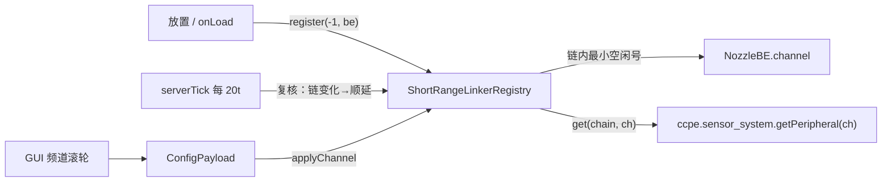

# 矢量喷管 `ccpe:advanced_thrust_nozzle` 工作记录

> 状态（2026-11）：**全部落地并经用户实测确认**
> —— 可转动模型 + 四活塞随动 ✅、频道 + 右键 GUI ✅、CC:T 外设（偏转 / 出力）✅；
> `./gradlew.bat classes` 通过、用户进游戏验证"没问题"。
>
> 六个能力一句话版：
> 1. **可倾斜喷口**：固定底板 + 绕枢轴 `(8,1,8)px` 在**锥角 15° 内**任意指向的喷口本体；
> 2. **四活塞随动**：活塞头固定（0 自由度）、活塞杆绕铰点转动（1 自由度），见 §4；
> 3. **推力 = 倾斜轴**：`nozzleAxis()` 钩子让推力与**全部粒子链路**一起跟着倾斜轴走；
> 4. **出力系数**：Lua `setThrustScale(0..1)` 乘在「风扇转速 × 气压」之上（默认 1.0）；
> 5. **物理体作用域频道**：放置自动分配、只在物理体上生效、与 `short_range_linker` / 控制台共享频道空间；
> 6. **CC:T 外设**：`setDeflection(方位角, 锥角)` / `getDeflection` / `getMaxTilt` / `isMoving` /
>    `setThrustScale` / `getThrustScale` / `getChannel`，可用 `ccpe.sensor_system.getPeripheral(ch)` 寻址。
> 7. **渐变到位**：Lua 只写目标，服务端**恒速**推进、客户端本地指数逼近平滑（§6.5），方位走最短路径。
>
> 母文档：`memo/thrust-nozzle.md`（定向喷管 `ccpe:thrust_nozzle` 本体；本方块**继承**它的一切）。

---

## 1. 需求与决策链（用户定稿）

| 议题 | 结论 |
|---|---|
| 参考对象 | `aeronautics:gyroscopic_propeller_bearing`（固定体 + 可倾盘 + 四个动态小活塞） |
| 与参考的差别 | 参考是"**固定体在下、可动盘在上**"；本方块是"**固定底板在下、可动 block 在上**"，**活塞上下镜像** ⇒ 自由度必须重算（§4） |
| 固定/可动划分 | 固定 = 底板 `base.json`；可动 = `block.json`（裙边 + 筒身 + 十字臂 + 顶环），绕枢轴 `(8,1,8)px` |
| 推力方向 | **倾斜后的轴向**（锥内任意方向，矢量引擎语义） |
| 锥角钳位 | **15°**（几何依据见 §6.3） |
| 角度 API 形态 | `setDeflection(方位角, 锥角)`（不是方向向量），另给 `getDeflection` / `getMaxTilt` |
| 出力 API | `setThrustScale(0..1)` 乘在「转速 × 气压」上，默认 **1.0**（不改变已有飞机行为） |
| 选择框/碰撞箱 | **整块正方形**（阶段一用户定稿；倾斜无法用 VoxelShape 表达） |
| GUI 内容 | **只有频道滚轮**，不做"加载物理体"开关（喷嘴不持有 force-load ticket） |
| 频道作用域 | 物理体（含约束链）；非物理体**不注册** |
| 外设方法 | 本阶段提供偏转 + 出力 + `getChannel`（早期一版曾定"暂不给 getChannel"，最终按外设形态给回） |
| 偏转是否瞬间到位 | **否**：Lua 只写目标，服务端**恒速**推进（§6.5），客户端用同一速度的墙钟纯函数画 |
| 渐变参数 | **写死在代码里**（方位 120°/s = 6°/tick、锥角 40°/s = 2°/tick、出力 0.25/tick），Lua 不提供速度/时长参数 |
| 平滑算法 | 视觉角 = **墙钟纯函数**（`System.nanoTime`，§6.5 v6）；**不要**改回"每 tick 累加"或"按渲染调用频率推进" |
| 方位角跨 0/360 | 走**最短路径**（350°→10° 走 −20°） |
| `getDeflection` 返回 | **实际角 + 目标角都给**，另加 `isMoving()` |
| 出力系数是否渐变 | **是**，与角度同一套曲线（数值单位改成"系数/秒"） |

---

## 2. 结构与模型

模型目录 `src/main/resources/assets/ccpe/models/block/advanced_thrust_nozzle/`（用户自建 Blockbench 模型）：

| 文件 | 内容 | 用途 |
|---|---|---|
| `base.json` | `x2..14, y0..2, z2..14` | **固定底板**，走 blockstate 静态渲染 |
| `block.json` | 裙边 `y1..5`、筒身 `y4..13`、四条十字臂 `y6..10`（伸到方块四边）、顶环 `y13..16` | **可动部分**，走 BER 动态渲染 |
| `piston_head.json` | 2×2×6px 小方块 | 4 个活塞头（固定件） |
| `piston_pole.json` | 1×7×2px 连杆 | 4 个活塞杆（可动件） |
| `item.json` | 上面全部 + `groups` 静态摆位 | 物品模型；**group 的摆位是几何基准的权威来源** |

**几何基准（从 `item.json` 反推，单位 px）**

| 部件 | 距中轴 | 高度 | 切向宽 |
|---|---|---|---|
| 活塞头 | **6..8** | **0..2** | 6 |
| 活塞杆 | **6..7** | **1..8** | 2 |
| 枢轴 | — | **y=1**（底板中部）、x/z=8 | — |

⇒ **铰点 = 杆底面中心 = 距中轴 6.5px、高度 y=1px**（§4.3 的模型定位约定就用这个点）。

---

## 3. 渲染（`AdvancedThrustNozzleRenderer`）

### 3.1 只走 BER，不注册 Flywheel Visual

照 `MyBearingPlateRenderer` 的先例：**没有 Visual 时 Flywheel 不会跳过原版 BE 渲染**，所以 BER 是唯一渲染来源。
⚠️ 因此渲染器里**不能**加 `VisualizationManager.supportsVisualization(...)` 提前返回，否则装 Flywheel 就整个消失。

### 3.2 变换链（外 → 内）

```
FACING 旋转（与 blockstate 的 x/y 旋转严格一致）
  → 绕枢轴倾斜 rotateAround(tilt, PIVOT)          // = translate(+P)·rotate·translate(−P)
  → 各部件自身平移 / 方位旋转
```

- **FACING 链逐步照抄已验证的 `ServoBearingRenderer`**：
  水平朝向先 `rotateCentered(rad(horizontalAngle(反朝向)), UP)`，再
  `rotateCentered(rad(-90 - verticalAngle), EAST)`——它与本方块 blockstate 的
  up/down(x180)/north(x90)/east·south·west(x90+y90·180·270) 六变体逐条对应。
- ⚠️ **`SuperByteBuffer` 的变换是"先调用 = 外层"**（内部 `PoseStack` 累乘 + `renderInto` 末尾自动 `reset()`，
  所以同一个 partial 在一个循环里画 4 次也不会累积变换）。外层必须先调用，部件平移最后调用。
- 枢轴 `PIVOT = (8,1,8)px = (0.5, 1/16, 0.5)`。

### 3.3 倾斜姿态来源

`AdvancedThrustNozzleBlockEntity#getRenderTiltQuaternion(float frameTicks)`：把模型空间 `+Y` 转到 `tiltDirModel()`
（由方位角 / 锥角派生）的**最小弧**四元数。渲染版先把服务端同步来的当前角经
`JoystickTilt#approach`（指数逼近、帧时间修正）平滑到本地动画状态，再合成四元数（§6.5）。
物理侧 `nozzleAxis()` 用同一个方向的**当前值**再按 blockstate 旋转转到 plot 系 ⇒ **推力方向与视觉方向一致**。

---

## 4. 活塞机构（自由度，**前后写错过两版，最终版在这里**）

### 4.1 最终机构（用户实测确认"动画效果没问题"）

| 部件 | 隶属 | 自由度 | 实现（`AdvancedThrustNozzleRenderer`） |
|---|---|---|---|
| 活塞头 | **底座（固定件）** | **0** | `translate(hinge) + rotateY(azimuth)` —— 不吃 tilt、不上下移动 |
| 活塞杆 | **block（可动件）** | **1（绕铰点的转动）** | `translate(hinge) + rotate(tilt) + rotateY(azimuth)` —— **底面中心钉死在铰点**，随 block 倾斜 |

视觉结果 = **固定的头 + 绕铰点转动的杆 + 上下滑过杆顶的 block**；杆顶始终在十字臂带（y6..10px）里被挡住
（15° 时杆顶摆幅 ≈ `7px·sin15°` ≈ 1.8px，臂带竖向余量足够）。

### 4.2 两版错误（别再犯）

| 版本 | 做法 | 为什么错 |
|---|---|---|
| v1 | 照参考"头贴倾斜面升降、杆保持竖直" | 参考是"头顶在转盘上、杆朝下插进固定体"，本方块**上下镜像**，头在那个高度只能是固定件 |
| v2 | 头固定 + 杆沿自身轴**滑动**（`s = r·(N·d) + h0·(cosθ−1)`） | 方向对了一半，但用户要的是**"底面一点钉死、只许绕它转"**——真正的一自由度是**转动**，棱柱滑动会让底面离开铰点 |
| v3 ✅ | 头 0 自由度 + 杆绕铰点转动 | 见 §4.1 |

### 4.3 模型定位约定：**局部原点 = 铰点**（关键约定）

两个 partial 模型的局部原点都放在同一个铰点上，于是代码里每个活塞只要
`translate(铰点)` + `rotate(...)`，**零偏移常量**（唯一常量 `PISTON_HINGE_RADIUS = 6.5/16`）：

| 模型 | 目标坐标 | 含义 |
|---|---|---|
| `piston_pole.json` | `from [-0.5, 0, -1] to [0.5, 7, 1]` | 底面中心 = 原点，杆沿 **+Y** 向上 7px；径向 1px(X)、切向 2px(Z)；**局部 +X = 径向朝外** |
| `piston_head.json` | `from [-0.5, -1, -3] to [1.5, 1, 3]` | 原点落在头内部（X −0.5..+1.5 = 距轴 6..8px、Y −1..+1 = y0..2px、Z −3..+3 = 切向 6px） |

> 改动模型时**只改 `from`/`to`**，UV 与尺寸不变；若在 Blockbench 里重新导出，必须保持这两个坐标，
> 否则会退回旧定位（游戏读的是导出的 json）。

---

## 5. 频道 + 右键 GUI

### 5.1 直接复用 `ShortRangeLinkerRegistry`（不新造注册表）

关键发现：`compat/cc/ShortRangeLinkerRegistry` 本来就是"物理体作用域频道表"
（`子次元UUID → (频道 → BlockEntity)`），而且**控制台早就和链接器共用它**。

| 能力 | 现成实现 |
|---|---|
| 放置自动分配（链内最小空闲） | `register(desired < 0, be)` |
| 同链冲突顺延 | 同上（返回实际频道） |
| **非物理体不注册** | 同上（返回 `-1`）⇒ 正好是"只在物理体上生效" |
| 按链查询 / 占用快照 / 注销 | `get(chainUuids, ch)` / `occupiedChannels(...)` / `unregisterAll(be)` |

频道号语义 = **喷嘴在物理体内的地址**（同链 1:1），与链接器/控制台共享同一频道空间。

### 5.2 生命周期

- `onLoad` → 注册；`setRemoved` → 注销；
- **`serverTick` 每 20 tick 复核**（轴承连/断后约束链变化 ⇒ 频道空间合并/拆分，同链冲突要顺延）；
- 离开物理体（拆到地上）⇒ `channel` 复位 `-1`，重新装上再自动分配；
- GUI 改动走 `AdvancedThrustNozzleConfigPayload` → 服务端 `applyChannel(desired)`（顺延回写 + 广播占用快照）。

数据流：



### 5.3 文件

| 文件 | 内容 |
|---|---|
| `screen/AdvancedThrustNozzleMenu.java` | 照 `ShortRangeLinkerMenu`，**去掉 bodyLoad**：pos / onPhysicsBody / channel / occupiedChannels |
| `screen/AdvancedThrustNozzleScreen.java` | 照 `ShortRangeLinkerScreen`：频道滚轮（跳过同链占用 + Shift ×10）+ 非物理体提示 + tooltip 前景层 + 完成按钮；背景**复用** `textures/gui/gui_link.png` |
| `network/AdvancedThrustNozzleConfigPayload.java` / `…PacketHandlers.java` | pos + channel；服务端二次校验"非物理体忽略"→ `applyChannel` → 刷新占用快照 |

### 5.4 状态与坑

- `onPhysicsBody` **不落盘、也不进 update tag**：客户端以 `channel >= 0` 推断。
- **蓝图部署后频道会重新分配**：父类 `ThrustNozzleBlockEntity` 没实现 `SafeNbt.writeSafe`，本轮未补
  （喷嘴的频道是"地址"，重分配可接受）。要持久化就给 BE 补 `writeSafe`/`readSafe`。
- 打开 GUI 前必须 `refreshOccupiedChannels()`，否则滚轮跳过的是旧占用。

---

## 6. CC:T 外设（偏转 + 出力）

### 6.1 Lua API（type = `advanced_thrust_nozzle`）

| 方法 | 语义 |
|---|---|
| `setDeflection(azimuthDeg, tiltDeg)` → bool | 方位角绕 FACING 轴（0..360，负值自动归正）、锥角自动钳到 `0..15`；非有限值返回 false。**只写目标值**，喷口按运动曲线渐变过去（见 §6.5），方位走最短路径。**推力方向 + 排气/进气/尾迹粒子 + 渲染同时渐变** |
| `getDeflection()` → `{azimuth, tilt, targetAzimuth, targetTilt}` | `azimuth`/`tilt` = 此刻**实际**角（渐变中与目标不同），`targetAzimuth`/`targetTilt` = 目标角；方位均已归正 0..360 |
| `getMaxTilt()` → `15` | 钳位上限（脚本归一化用） |
| `isMoving()` → bool | 是否还在渐变中（偏转或出力尚未到位） |
| `setThrustScale(scale)` → bool | 出力系数 0..1（越界钳位），乘在「风扇转速 × 气压」之上；**只影响推力，不影响粒子**；同样按运动曲线渐变 |
| `getThrustScale()` → 0..1 | 当前出力系数（渐变中是此刻实际值） |
| `getChannel()` → int | 本喷嘴在物理体内的频道（-1 = 不在物理体上 / 未分配） |

用法：

```lua
local ss = require("ccpe.sensor_system")
local n  = ss.getPeripheral(0)        -- 频道 0 的喷嘴（物理体内自动分配的号）
print(n.getChannel(), n.getMaxTilt()) -- 0  15
n.setDeflection(90, 15)               -- 绕轴转 90° 再倾 15°（渐进去，约 0.8s）
n.setThrustScale(0.5)                 -- 出力减半（粒子不变，同样渐变）
print(n.getDeflection().tilt, n.getThrustScale())

-- 等它转到位
while n.isMoving() do sleep(0.05) end
print(n.getDeflection().azimuth, n.getDeflection().targetAzimuth) -- 两个相等
```

### 6.2 父类的两个钩子（**定向喷管行为不变**）

在 `ThrustNozzleBlockEntity` 新增：

| 钩子 | 默认行为 | 作用 |
|---|---|---|
| `protected Vec3 nozzleAxis(BlockState)` | 返回 FACING 法线 | 推力（`sable$physicsTick` 冲量）与**全部粒子链路**（喷口位置、粒子基向量、遮挡射线、进气漏斗、尾迹锚点）的唯一方向来源 |
| `protected double thrustScale()` | 返回 1.0 | 乘在「转速 × 气压」上的额外出力系数 |

矢量喷管覆盖它们（`nozzleAxis` 返回倾斜轴转到 plot 系、`thrustScale` 返回 Lua 设的值）⇒ **一处改、全链路生效**。

### 6.3 两个几何/数学要点

1. **模型空间 → plot 系的旋转**（最容易搞错）：vanilla blockstate 的模型旋转是
   **`R = Ry(−y) · Rx(−x)`**（`new Quaternionf().rotationYXZ(rad(−y), rad(−x), 0)`），
   六个朝向的 (x,y) 与 `blockstates/advanced_thrust_nozzle.json` 逐条对应：
   up (0,0)、down (180,0)、north (90,0)、east (90,90)、south (90,180)、west (90,270)。
   顺序用错会表现为"倾斜方向对、但推力朝反方向 / 转 90°"。
2. **为什么锥角钳 15°**：枢轴在 `y=1px`（底板中部），裙边下沿半径 ~5-6px ⇒ 下垂量 `6px × sinθ`：
   15° ≈ 1.6px（刚好）、20° ≈ 2.1px（可见地切进底板）、30° ≈ 3px（明显）；
   活塞杆摆幅 `7px × sinθ` 同理，15° 时 1.8px 正好仍在十字臂带内。

### 6.4 注册与同步

- `compat/cc/CCPeripheralCapabilities` 加一条 capability → `getPeripheral()`（懒加载内嵌 `Peripheral`）。
- `compat/cc/SensorSystemAPI#getPeripheral(ch)` 加喷嘴分支（链接器 → 控制台 → **喷嘴**，三者同一频道空间）。
- `azimuthDeg` / `tiltDeg` / `thrustScale` 进 `saveAdditional`；前两个**还要进 `getUpdateTag`**
  （客户端 BER 与粒子要读）；**动的时候每 tick 推一次** `sendBlockUpdated(..., 3)`，停下就停发。

### 6.5 渐变到位：视觉角 = **一个朝 target 走的数**（每次渲染用墙钟差值推进一步）

**七版演进（别再走回头路）**

| 版本 | 动画时钟 / 做法 | 结果 |
|---|---|---|
| v1 | 服务端梯形曲线 + 客户端 `partialTicks` 在 prev→current 插值 | ❌ "看起来有点怪" |
| v2 | 追**同步来的当前角**（`JoystickTilt#approach`）+ 每 tick 广播 | ❌ "卡卡的" |
| v3 | 渲染里按**帧时间**追目标角 | ❌ 仍"卡卡的" |
| v4 | 客户端 **BE tick** 推 prev/current + `Mth.lerp(partialTicks, …)`（照 `create-propulsion-simulated`） | ❌ "完全没有动画，直接瞬移" |
| v5 | `AnimationTickHolder.getRenderTime` 当纯函数时钟 | ❌ 仍"瞬间到达" |
| v6 | `System.nanoTime` 墙钟当纯函数时钟 + `(from, to, start)` 三元组 | ❌ **实测 `out` 恒为 `(90,15)`**：包正常到、`target` 正常在变，但 `animTo` 自第一包后不再更新 ⇒ `from == to` ⇒ 永远不动 |
| v7 ⏳ | **视觉角只是一个数**：`visual += sign(target−visual) × 速度 × Δt`（Δt 来自 `nanoTime` 差值） | 待实测 |

**教训（每一版都死在"时钟"或"存下来的状态"上）**
1. 不能用同步包频率（v2）；
2. 不能用渲染调用频率（v3）；
3. 不能用客户端 BE 的 tick 计数（v4，物理体/子次元上不可靠 —— 用户提示"monitor 的 knob/joystick 也踩过"）；
4. 也不能在渲染路径上用 `level.isClientSide` 做提前返回（v5：物理体/子次元上的侧标记不可靠，
   一旦判成服务端就返回真值 ⇒ 直接在视觉上"瞬移"到目标）；
5. **不要存 `(起点, 终点, 起始时刻)` 三元组**（v6）：一旦其中一步没更新就永久卡死，且**没有自愈路径**；
   视觉角只保留"一个数 + 直接读 target"，就没有可失效的中间状态。

**v7 的状态与算法**

| 项 | 做法 |
|---|---|
| 状态 | `visualAzimuthDeg` / `visualTiltDeg` / `visualLastNanos` / `visualInit`（**仅此四个**） |
| 推进 | `advanceVisualAnimation()`：`Δt = nanoTime − visualLastNanos`（单次上限 0.25s），`visual = stepToward(visual, target, 速度×Δt)` |
| 频率无关 | `Δt` 是**差值** ⇒ 一帧内渲染被调用两次（多 pass）、或帧率高低，积分都正确 |
| 首次 | `visualInit`：第一次渲染直接落在同步来的当前角（不从 0 追） |
| 同步包 | `handleUpdateTag` 只 `setSynced(value, target)`，**完全不碰视觉角** —— target 变了视觉角自然追过去 |
| 调试 | `DEBUG_ANIM_LOG`（默认 `false`）：打开后每 4 次渲染打印 `visual / target / value / dt` |

| 参数 | 当前值（排查用，放慢） | 耗时 |
|---|---|---|
| `AZIMUTH_DEG_PER_SECOND` | 120°/s | 方位 90° = 0.75s、180° = 1.5s |
| `TILT_DEG_PER_SECOND` | 40°/s | 锥角满行程 15° = 0.38s |
| `THRUST_SCALE_PER_TICK` | 0.25/tick | 出力 0→1 = 0.2s |

> 确认观感后可把两个常数改快（最初想要的手感约 400°/s / 100°/s ⇒ 90° 0.22s、15° 0.15s）。

**要点**

| 项 | 做法 |
|---|---|
| 三条轴 | `Axis` 只有 `value`（服务端真值 / 客户端同步值）+ `target` |
| Lua 写什么 | `requestDeflection/requestThrustScale` **只写 target**（方位先经 `shortestTargetAzimuth` 换成最短路径的连续目标，可能落在 0..360 之外） |
| 落盘 | 只存当前角（+ 出力系数）；目标不落盘 ⇒ 中途退出游戏，读档停在当时的角度，不会自己动 |
| 调试日志 | 渲染线程上的同步 stdout 会掉帧 ⇒ `DEBUG_ANIM_LOG` 默认关闭，只在排查时临时打开 |

---

## 7. 文件清单

### Java

| 文件 | 职责 |
|---|---|
| `block/AdvancedThrustNozzleBlock.java` | `extends ThrustNozzleBlock`：整块选择框、自己的 BE 类型、`getTicker`（客户端粒子 / 服务端频道复核）、空手右键开 GUI |
| `block/AdvancedThrustNozzleBlockEntity.java` | 频道状态机 + 图标 NBT/同步 + 偏转角 / 出力系数 + 内嵌 CC:T `Peripheral` + `nozzleAxis`/`thrustScale` 覆盖 |
| `block/AdvancedThrustNozzleRenderer.java` | 只走 BER：block 部分（绕枢轴倾斜）+ 4 活塞头 + 4 活塞杆 |
| `screen/AdvancedThrustNozzleMenu.java` / `…Screen.java` | 频道 GUI |
| `network/AdvancedThrustNozzleConfigPayload.java` / `…PacketHandlers.java` | 频道保存 |
| `block/ThrustNozzleBlock.java`（微改） | 抽 `createBlockEntity` / `entityType()` / `shapeFor(Direction)` 三个钩子 |
| `block/ThrustNozzleBlockEntity.java`（微改） | 加 `protected (BlockEntityType, BlockPos, BlockState)` 构造器 + `nozzleAxis` / `thrustScale` 钩子 |
| `block/MyModPartialModels.java` | +3 PartialModel：`ADVANCED_THRUST_NOZZLE_{BLOCK,PISTON_HEAD,PISTON_POLE}` |
| 注册 | `MyModBlocks` / `MyModBlockEntities` / `MyModCreativeModeTabs` / `MyModMenus` / `ModPackets` / `CCPeripheralExtenderClient`（BER + Screen）/ `CCPeripheralCapabilities` / `SensorSystemAPI` |

### 资源

`blockstates/advanced_thrust_nozzle.json`（**只指到 `base`**，六变体同 thrust_nozzle）、
`models/item/advanced_thrust_nozzle.json`、loot_table、physics_block_properties（mass/volume 0.5/0.5）、
recipe、lang（`block.ccpe.advanced_thrust_nozzle*` + `gui.ccpe.advanced_thrust_nozzle.require_body`）。

---

## 8. 已知边界 / 未做

- **偏转速度写死**（方位 20°/tick、锥角 5°/tick、出力 0.25/tick，**无加减速**），Lua 不可配（用户定稿）。
- 渐变中**中途保存只落盘当前角**：目标不存 ⇒ 读档停在当时角度（不会续着转）。
- 推力**不做遮挡判定**（与定向喷管一致：喷口被堵照样出力）。
- 蓝图部署后**频道重分配**（父类无 `writeSafe`）；偏转/出力有 NBT 会保留。
- 没有"实际出力 pN"读数（需要调试时加 `getThrust()`）。
- `getDeflection` 只给两个角度，不给世界系方向向量（需要时可以加）。
- 选择框是整块正方形；要贴合模型需做"最大倾角包络"。
- 活塞机构只有 4 个方位（`rotateY(-90°·i)`），不支持任意角度的活塞数量。

---

## 9. 验证记录

| 项 | 结论 |
|---|---|
| block 部分绕 (8,1,8)px 转、六向 FACING 都对 | ✅ 用户实测"转动正常" |
| 活塞机构（头固定 + 杆绕铰点转） | ✅ 用户实测"动画效果没问题了" |
| 整块选择框 / 碰撞箱 | ✅ |
| 频道自动分配 / 只在物理体 / GUI | ✅ 用户实测"这一步没问题" |
| CC:T 外设偏转 + 出力 | ✅ 用户实测"没问题" |
| 偏转渐变（视觉角 = `System.nanoTime()` 墙钟纯函数） | ⏳ v7 代码完成、`classes` 通过：**删掉**渲染路径的 `System.out.printf`、**只在目标变化时**重启视觉动画（原来无条件重启会被重复 BE 更新包采样成 20Hz 抖动）；待用户实测观感 |

---

## 10. 参考来源（均只读）

| 参考 | 借鉴点 |
|---|---|
| `references/Simulated-Project-main/aeronautics/.../gyroscopic_propeller_bearing/{GyroscopicPropellerBearingRenderer,GyroscopicPropellerBearingVisual,GyroscopicPropellerBearingBlockEntity}.java` | 枢轴倾斜手法（`translate(+pivot) → rotateCentered → translate(−pivot)`）、四活塞位置/朝向、`tiltQuat` + previous/插值、锥角钳位思路 |
| `references/create-propulsion-simulated-main/.../vector_thruster/{VectorThrusterBlockEntity.java,VectorThrusterRenderer.java}` | **偏转动画的运行时骨架**：客户端自己 tick 推 `prev/current`、渲染 `Mth.lerp(partialTick, …)`、只在命令时 `notifyUpdate`（§6.5 v4） |
| 同目录 `piston_head.json` / `piston_pole.json` | 与本方块这两个 partial 模型几何逐位相同（**但活塞自由度是镜像的，只能参考变换链手法**） |
| `block/ServoBearingBlockEntity.java` 内嵌 `Peripheral` + `block/ServoBearingRenderer.java` | CC:T 外设写法（`getType`/`equals`/`@LuaFunction(mainThread=true)`/懒加载）与六向 FACING 渲染链 |
| `block/ShortRangeLinkerBlock.java` / `…BlockEntity.java` / `screen/ShortRangeLinker*` / `network/ShortRangeLinker*` | 频道注册生命周期、GUI（滚轮 + 非物理体提示 + tooltip 前景层）、payload 处理器 |
| `compat/cc/ShortRangeLinkerRegistry.java` | **物理体作用域频道表**（自动分配 / 顺延 / 链聚合 / 非物理体返回 -1） |
| `block/MyBearingPlateRenderer.java` | "只走 BER、不注册 Visual"的合法范例 |
| `memo/thrust-nozzle.md` | 母文档：推力/气压/粒子/尾迹/染料/扳手全部继承自它 |
