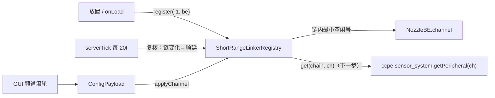

# 定向喷管（`ccpe:thrust_nozzle`）工作记录

> 状态（2026-08 末）：**推力 / 排气（含轻微重力）/ 高空尾迹 / 染料染色 / 配置化 / tooltip / 扳手拆除 全部完成，
> `gradlew classes` 通过；斜喷穿墙已修复并经用户多角度实测确认**。
>
> **另见 §18**：矢量喷管 `ccpe:advanced_thrust_nozzle`（加强版，固定底板 + 可在锥角内倾斜的喷口本体 +
> 四个随动小活塞，参考 `aeronautics:gyroscopic_propeller_bearing`）。**阶段一（可转动模型）待进游戏验证**，
> 阶段二（锥角控制 / 推力改用倾斜轴 / Lua 外设）尚未开始。
> **交接速览见 §13**（文件清单、玩家可见行为、参数在哪、待办）；**穿墙修复 + 重力的完整记录见 §14**，
> **扳手快速拆除见 §15**。
> 缺合成配方；模型/贴图由用户完成。
>
> 六个能力一句话版：
> 1. **推力**（§2.1）：`THRUST_PER_RPM = 1` ⇒ 1 RPM = 1 pN，气压 1.0 时 256 RPM = 256 pN/管，且随气压缩放；
> 2. **排气 `ccpe:exhaust`**（§3.6）：世界坐标、扫掠碰撞 + 撞墙反弹 + 沿面滑行、越老越大/越慢/越淡；
>    **轻微重力**由配置 `exhaustGravity`（默认 0.02）控制，设 0 = 失重；撞地分裂按用户要求关闭；
> 3. **高空尾迹 `ccpe:contrail`**（§9）：按移动距离发射、峰值适宜度曲线（Y160 起 / 183~224 最浓 / 320 最稀）、
>    匀速直线飘荡（速度 = 总飘荡距离 ÷ 寿命，§9.10）、无碰撞无重力、9 参数 `addAlwaysVisibleParticle` 远处可见；
> 4. **染料染色**（§10）：手持染料右键喷口 ⇒ 只染**尾迹**粒子，护目镜 tooltip 显示当前染色；
> 5. **配置 + tooltip**（§11、§12）：17 个参数进 `config/ccpe-client.toml`（改完即时生效）；物品 tooltip 走 Create `ItemDescription`；
> 6. **扳手拆除**（§15）：`IWrenchable` ⇒ `create:wrench` **潜行右键快速拆除**（掉落直接进背包）、普通右键不旋转。
>
> 第 7 个能力（2026-08 末新增）：**进气粒子 `ccpe:intake`**（§16）——负转速 = 吸力时，
> 空气从喷口前方被**吸进口面**（加速收拢 + 缩小淡出）；此前负转速下**一颗粒子都没有**。
> v2（§16.9）：**漏斗长度随转速缩放**（满 256 RPM = 8.0 格，128 RPM 减半）。
>
> **仍待进游戏确认**（其余已由用户实测确认）：配置**界面**的标题/说明文案、物品 tooltip 展开、
> "潜行空手清除染色"已移除、**扳手潜行右键拆除 / 普通右键不旋转**（§15.3）、**进气粒子观感**（§16.7）。
> 上游背景见 `memo/flip-autopilot.md`（火箭方案作废 ⇒ 自研喷管）；相关 `memo/my_sensor_system.md`、`memo/api-code-map.md`。

## 0. 需求与决策链（用户定稿）

| 议题 | 结论 |
|---|---|
| 动力来源 | 仍装在 `create:encased_fan` 出风面，**力由风扇转速决定**（不新增 CC 写入，Lua 脚本一行不改） |
| 力的模型 | **纯轴向推力**：不做射线、不看表面 ⇒ 任意**距离**出力相同；**乘气压**（§2.1.1）⇒ 高度有影响 |
| 强度 | **1 RPM = 1 pN**（`THRUST_PER_RPM = 1`）⇒ 气压 1.0 时 256 RPM 单管 **256 pN**。用户第三次定稿，图公式简单；初版 800 pN 实测"高达 750 多"过猛，200 pN 偏软 |
| 方块名 | `ccpe:thrust_nozzle` |
| mixin | **不需要**（见 §1） |
| 尾迹高度窗口 | **Y 160~320**，Y<160 完全无尾迹；实际做成**峰值曲线**（Y≈183~224 最浓，往上变稀），见 §9.8 |
| 尾迹发射 | **按移动距离**发射（悬停不动 ⇒ 零发射），见 §9.3 |
| 尾迹飘荡 | **匀速直线**：速度 = 总飘荡距离 ÷ 寿命，方向随机；云层以上 ×1、越低越散（模拟对流层湍流），见 §9.10 |
| 湿度 | **不计算**，全部退化为高度/温度函数 |
| 染色 | 手持**染料**右键喷口 ⇒ 只染**尾迹**粒子；护目镜显示当前色；**无清除入口**（潜行空手清除已删除），见 §10 |
| 性能参数 | **17 项全部进配置** `ccpe-client.toml`，见 §11 |
| 物品 tooltip | Create `ItemDescription`：装在风扇出风面增加出力 / 高空产生尾迹 / 染料改色，见 §12 |

## 1. 源码结论：为什么不需要 mixin

### 1.1 Create 侧（`api/create-1.21.1-6.0.10-280-sources/.../kinetics/fan/`）

- `NozzleBlock`：纯方向方块，`canSurvive` 要求背后是 `IAirCurrentSource` 且
  `getAirflowOriginSide() == FACING`（`EncasedFanBlockEntity.java:73-76` 直接返回 `FACING`）。
- `NozzleBlockEntity`：**对物理体零作用**，只对原版实体 `setDeltaMovement(+ pushVec·1/32)`（108-112 行）；
  `range = source.getMaxDistance()`。对 Sable 物理体出力的其实是 Sable 的 mixin。

### 1.2 Sable 侧（`references/sable-main/neoforge/.../mixin/compatibility/create/nozzle/`）

- 运行时已装的三件套：`NozzleHoveringMixin`（实现 `BlockEntitySubLevelActor`）、
  `NozzleHoveringHelper`（射线 + 力公式）、`NozzleBEFixesMixin`（子次元坐标修正）。
- 力公式：13 根射线（6 根水平伞 + 6 根 45° + 1 根轴向），射线长 **6.4 格**，3.2 格内满功率，
  `force = 5 · scale · softSpeed(>128 RPM 时 128+(rpm-128)/4) · airPressure · Σp/13`。
- **实测反解**：256 RPM ⇒ `softSpeed = 160` ⇒ 理论上限 800 pN；实测 319.46 pN ⇒ `Σp/13 ≈ 0.4`
  （即旧喷嘴只用出理论 40%，其余丢在射线打空/打斜）。这也正好对应 §0 的 800 pN 标定基准。

### 1.3 为什么不能"继承 + 改数"

- `getFanMagnitudeCalculation` 是 **private static**，射线数 `N=13` 做分母，`rayPoints` 是 mixin 的
  `@Unique` 字段 ⇒ 子类拿不到任何改写点；
- Sable 的力逻辑住在 **mixin 类**里，Mixin 不能再 mixin 另一个 mixin；
- 本项目已有 3 个 `BlockEntitySubLevelActor` 实现（`MyBearingBlockEntity`、`MyBearingPlateBlockEntity`、
  `TrailingWheelMountBlockEntity`）⇒ 自研方块 + BE 的成本最低、且完全可控。

### 1.4 重要发现：装喷嘴后风扇自身推力归零

`fans_provide_force/EncasedFanBlockEntityMixin.java:27-30,57-60`：Sable 的螺旋桨推力
`isActive() = !blocked && |propSpeed| > 0.01`，其中 `blocked = !level.getBlockState(pos.relative(FACING)).isAir()`。
喷管恰好占住那一格 ⇒ **风扇那一路推力恒为 0**，总推力 = 喷管这一路，数值可预测、不会叠加。
旧喷嘴的 "68 pN → 319 pN（4.68 倍）" 本质是"关掉机制 A、启用机制 B"，不是放大。

## 2. 实现

| 文件 | 内容 |
|---|---|
| `src/main/java/com/zzy205/myfirstmod/block/ThrustNozzleBlock.java` | `DirectionalBlock` + `EntityBlock`；`FACING` = 点击面；`canSurvive` / `neighborChanged` 照抄 `create:nozzle`；六向选择框/碰撞盒；**仅客户端** `BlockEntityTicker` |
| `src/main/java/com/zzy205/myfirstmod/block/ThrustNozzleBlockEntity.java` | `BlockEntity implements BlockEntitySubLevelActor`；`sable$physicsTick` 施加轴向点力；`tickClient` 喷粒子 |
| `block/MyModBlocks.java` | 注册 `ccpe:thrust_nozzle`（`registerBlocks` 自动带 BlockItem），音效 `SoundType.COPPER`。⚠️ **创造栏不是自动的**：本模组的标签页用显式 `output.accept(...)` 列表，必须手动在 `item/MyModCreativeModeTabs.java` 加一行（§17） |
| `block/MyModBlockEntities.java` | 注册 `thrust_nozzle` BE |
| `assets/ccpe/blockstates/thrust_nozzle.json` / `models/item/` / `models/block/`（用户 Blockbench 模型）/ `textures/block/thrust_nozzle.png` | 资源；blockstate 未旋转变体 = `facing=up` |
| `data/ccpe/loot_table/blocks/thrust_nozzle.json` | 挖掘掉落 |
| `data/ccpe/physics_block_properties/thrust_nozzle.json` | `sable:mass = 1.0`、`sable:volume = 0.5`（对齐 memo 里"每个喷嘴 1 kg"） |
| `assets/ccpe/lang/en_us|zh_cn.json` | Directional Thrust Nozzle / 定向喷管 |

### 2.1 力模型（`sable$physicsTick`）

```
pressure  = DimensionPhysicsData.getAirPressure(level, worldCenterOf(nozzle))  // 海平面 1.0
magnitude = (REVERSE_SIGN ? -1 : 1) · THRUST_PER_RPM · fanRpm · pressure · timeStep   // pN·s（含符号）
impulse   = -facingNormal · magnitude                                        // plot/机体局部系
group.applyAndRecordPointForce(centerOf(worldPosition), impulse)             // sable:propulsion 力组
```

- `THRUST_PER_RPM = 1.0 pN/RPM` ⇒ **出力数值 = 转速数值**（256 RPM ⇒ 256 pN），无需换算；
  **线性**（没有 Sable 的 >128 RPM 软缩放），
  保持 memo §6.5 已验证的"推力 ∝ 转速"手感。
- `REVERSE_SIGN = false` 是**进游戏实测校定的正确值**：正转速 ⇒ 机体沿 **-FACING** 受力。
  喷口 `facing=down`（装车底）时：**正转速 = 上升/刹车，负转速 = 下压/贴地**，与旧喷嘴"正推反吸"一致；
  喷管随车身翻转，倒挂时"负转速 = 吸向头顶赛道"的语义不变。
  > **⚠️ 2026-10 重大修正（`axisStep`）**：上面"正转速 ⇒ -FACING"漏了一项 ——
  > 电扇自身推力路径（`references/sable-main/neoforge/.../fans_provide_force/EncasedFanBlockEntityMixin.java:44`）里，
  > `propSpeed = FACING.getAxisDirection().getStep() * angular * (10/3)`，而 `getStep()` 是
  > **UP = +1、DOWN = −1、四个水平方向恒 +1**。喷管原来没有这一项，于是：
  > 水平朝向看不出问题，**`facing=DOWN` 的喷管推力整体反向**（用户实测确认）。
  >
  > 补上 `axisStep` 修好了「水平正确 / 朝下反向」这个不对称（用户实测确认）。
  > **但由它推出的「竖直喷管统一为负转速 = 向上」随后被实测推翻**：实测每通道符号并不统一
  > （喷嘴组与前角扇 -256 为向下，后角扇 +256 为向下）。
  > ⇒ **符号只认 `vtel.lua` 的 `UP_SIGN` 表，不要用公式推**；推导与实测不符的根因尚未查清，
  > `tests ramp` 会自检整表符号（第 1 遍用当前表，不起飞就把整表取反再跑）。
- **力向量与作用点必须每次新建**：`QueuedForceGroup.applyImpulseAtPoint` 会**就地改写传入的 position**
  （减去质心求力臂），`recordPointForce` 又保留引用（`FlightDataRecorder` 遥测会读）；复用临时向量会污染数据。

#### 2.1.1 气压项（取数口径与 Sable 原版喷嘴逐位一致）

```
pressure = DimensionPhysicsData.getAirPressure(level,
             parentSubLevel.logicalPose().transformPosition(atCenterOf(fbe.getBlockPos())))
```

即 `NozzleHoveringHelper.java:173` 的写法，本项目搬进 `ThrustNozzleBlockEntity#airPressureAt(ServerSubLevel)`。

- 必须用**世界坐标**：气压是 y 的函数，而 BE 的 `worldPosition` 是 plot 坐标（§3.5），
  所以先 `logicalPose().transformPosition(...)` 投到世界系再取。漏这一步会取到 plot 里的 y，
  气压会在装配/移动瞬间乱跳。
- 开关 `THRUST_SCALES_WITH_AIR_PRESSURE`（现 true）、指数 `AIR_PRESSURE_EXPONENT`（现 1.0 = 纯线性乘）。
- 异常/非有限值一律退回 1.0：NaN 冲量进物理步会把物理体直接打飞。
- 曲线形状（`DimensionPhysics#createDefault`，无 datapack 覆盖时）：海平面 1.0、向上 `e^(−0.004·Δy)`
  指数稀薄、地底夹到 1.5、接近建筑限高最后 40 格平滑掉到 0。

#### 2.1.2 力组与施力

- 力组解析：**不能 `import ForceGroups`**（其静态字段类型是 veil 的 `RegistryObject`，veil 不在编译
  classpath，`FlightDataRecorder.java:320-323` 已踩过）；改用
  `ResourceKey.createRegistryKey(rl("sable","force_groups"))` + `registry.get(rl("sable","propulsion"))`。
- 打点力自带力臂 ⇒ 多喷管位置差自动产生力矩（滚转/俯仰），无需额外处理。

### 2.2 出力表（40.25 kg 车，重量 442.8 pN）

| 转速 | 单管 | 4 管 | ÷重量 |
|---|---|---|---|
| 256（100%） | 256 pN | 1024 pN | 2.31× |
| 192（75%） | 192 | 768 | 1.73× |
| 128（50%） | 128 | 512 | 1.16× |
| 102（40%） | 102 | 408 | 0.92× |

- 悬停油门（气压 1.0）：**4 管 ≈ 43%**（442.8/1024，≈111 RPM）、3 管 ≈ 58%、2 管 ≈ 87%。
- **单管永远飞不起来**：1.5 气压（地底）也只有 384 pN < 442.8 pN。至少 2 管，实务上 4 管。

**气压随高度（§2.1.1，主世界海平面 y=63，估算值）**

| y | 气压 | 单管 256 RPM | 4 管 | 说明 |
|---|---|---|---|---|
| ≤ −38 | 1.50 | 384 pN | 1536 | 地底饱和（夹到 1.5） |
| 63 | 1.00 | 256 | 1024 | 海平面 = 标定基准 |
| 163 | 0.67 | 172 | 686 | 悬停需 ≈65% 油门 |
| 213 | 0.55 | 141 | 564 | 悬停需 ≈79% 油门 |
| 263 | 0.45 | 115 | 461 | 悬停需 ≈96% 油门 |
| 273 | ≈0.432 | 111 | 443 | **4 管满载的升限（刚好 = 重量）** |
| 280 | 0.42 | 108 | 430 | 限高衰减段起点 |
| 320 | 0 | 0 | 0 | 建筑限高 |

- ⇒ **实用升限**（估算，4 管满载）：**y ≈ 273**（800 pN 版 ≈305、200 pN 版 ≈210）。
- ⇒ 悬停油门变成高度的函数：**43% 只在海平面成立**，y≈163 时 ≈65%、y≈213 时 ≈79%、y≈263 时 ≈96%，
  y≳273 直接失去悬停能力。`flip-autopilot.md` 里按 14% 标定的控制律增益/死区**必须按高度重标**，
  或者让脚本读 `sensor` 的气压做前馈（`SensorSystemAPI` 已暴露气压，见 `memo/my_sensor_system.md`）。
- 左右差动（各 2 管、r=2 m、I≈160 kg·m²）：**单边满速** ⇒ τ = 2×256×2 = 1024 N·m ⇒ α_roll ≈ **6.4 rad/s²
  —— 刚好压在 `flip-autopilot.md` 的翻滚预算 6.4 线上**（余量为 0，姿态机动的偏差修正会很紧）；
  想留余量就**双边反向差动**（一侧 +256、另一侧 −256）：τ = (512+512)×2 = 2048 N·m ⇒ α_roll ≈ **12.8 rad/s²**。
- 落地：（4 管 1024 pN）/40.25 ≈ **25.4 m/s²**，吃掉 10 m/s 需 **0.39 s / 2.0 m**
  （800 pN 版 0.13 s / 0.65 m）⇒ FLARE 段的刹车距离预算按 2.0 m 排。

### 2.3 选择框 / 碰撞箱（六向）

- 基准盒（`facing=up` 未旋转模型帧，用户定稿）：`(1,13,1,15,16,15)` 顶盖 + `(2,0,2,14,13,14)` 筒身
  （顶盖贴满到 y=16，筒身 0~13）。
- 六向由 `rotateX`/`rotateY`（每 90° 的 AABB 映射）生成，与 `blockstates/thrust_nozzle.json` 的
  x/y 旋转**严格对应**：up 原样、down = x180、north = x90、east/south/west = north 再绕 Y 转 90/180/270。
  变换链照抄 `AicBlock`（已验证的案例）。
- `rotateX` 1 圈：`(x,y,z) → (x, z, 1−y)`；`rotateY` 1 圈：`(x,y,z) → (1−z, y, x)`。
- 生成结果（px）：up `(1,13,1,15,16,15)+(2,0,2,14,13,14)`；down `(1,0,1,15,3,15)+(2,3,2,14,16,14)`；
  north `(1,1,0,15,15,3)+(2,2,3,14,14,16)`；east `(13,1,1,16,15,15)+(0,2,2,13,14,14)`；
  south `(1,1,13,15,15,16)+(2,2,0,14,14,13)`；west `(0,1,1,3,15,15)+(3,2,2,16,14,14)`。
- 选择框与实体碰撞共用 `getShape`（`getCollisionShape` 默认转发），Sable 的 VoxelColliderData 也走它。

## 3. 粒子特效（三次迭代，别重踩）

### 3.1 平台事实（源码）

- `create:air`（`AirParticle`）：**位置插值**粒子（起点 → 起点+位移，按 `lifetime` 走完），
  `hasPhysics = false` **完全不碰撞**；`lifetime = 位移长度/speed`（整数，**硬上限 60**），
  `progress = (age/lifetime)^drag`；`AirParticleData` 只暴露 `drag`/`speed`，
  颜色、尺寸、8 帧精灵图全部写死。Sable 有 `AirParticleMixin`（`tick` 里按子次元姿态重投影）。
- `create:air_flow`（`AirFlowParticle`，电扇自己用的）：方向/速度/`bounds` 全部由风扇
  `AirCurrent` 决定，`tick` 里做 `bounds.contains` 与 `maxDistance` 判定（61-78 行）。
- `AirCurrent.getFlowLimit()`（229-257 行）：沿 `FACING` 逐格看 `getCollisionShape()`，
  **遇第一个挡路方块就把 `maxDistance` 截断**；`shouldAlwaysPass` = 是否在 `create:fan_transparent` 标签里。
- 推论：喷管占住风扇前一格 ⇒ `maxDistance` 从 24 被截到 **~1.03 格**，
  `air_flow` 粒子速度掉到 ~0.06 格/tick 且几乎贴脸。

### 3.2 迭代历史

| 版本 | 做法 | 结果 |
|---|---|---|
| v1 | `create:air`，从喷口截面随机撒点 + 自定速度/寿命 | 可用（现行基础） |
| v2 | 完全复刻 `create:air_flow` + 把喷管加进 `create:fan_transparent` 标签，每 tick 追加 N 颗 | **观感不好，已回退**（标签还会让电扇的实体推力/批量加工穿过喷管生效） |
| v3 | 在 v1 上加**遮挡射线** | 现行基础 |
| v4 | 遮挡射线改到**世界系**（主世界方块才挡得住，§3.4） | 现行 |
| v5 | **自研粒子 `ccpe:exhaust`** + 扫掠碰撞 + 撞墙反弹/滑行 + 撞地变大（§3.6） | **现行**（第一版碰撞坐标系写错⇒撞墙无反应；后又修：出生点保护、碰撞冷却；撞地分裂已关闭） |
| v6 | 光照：`IGNORE_LIGHTMAP` 全亮渲染（§3.6 光照节） | 现行（修「黄黄的粒子」） |
| v7 | 随寿命演变：越大 / 越慢 / 越透明三条单调曲线（§3.6） | 现行 |

### 3.3 当前参数（⚠️ v1 的 `create:air` 回退路径，现在默认不走这条）

> 现在 `USE_EXHAUST_PARTICLE = true`，实际用的是 §3.6 的自研 `ccpe:exhaust`；
> 下表只有把 `USE_EXHAUST_PARTICLE` 改回 `false` 时才生效。
> **排气粒子目前的旋钮**：密度/寿命/尺寸/初速/重力/距离已进配置（§11.1 的 `exhaust*` 六项），
> 撞墙与视觉细节在 `ExhaustParticle` 顶部。

| 常量 | 现值 | 说明 |
|---|---|---|
| `MAX_PARTICLES_PER_TICK` | **10** | 满转速每 tick 颗粒数，按 `|rpm|/256` 缩放（同屏 ≈ 本值 × 寿命） |
| `PARTICLE_SPEED` | **1.0** | 平均速度（块/tick = 20 块/秒） |
| `PARTICLE_DRAG` | 0.7 | <1 = 出膛快、尾段减速 |
| `PARTICLE_TRAVEL_MIN/MAX` | **6.0 / 10.0** | 位移长度 ⇒ 寿命 = 长度/speed ≈ **6~10 tick** |
| `MIN_PARTICLE_TRAVEL` | 0.2 | 射线可走距离短于它就整段不生成 |
| `PARTICLES_BLOCKED_BY_OTHER_BODIES` | true | 其它物理体是否也挡粒子 |
| `INVERT_PARTICLE_FLOW` | false | 纯视觉翻向，不动物理 |

排气方向 = 机体受力的反向 = `+FACING · sign(rpm)`（随 `REVERSE_SIGN` 自动一致）。

### 3.4 遮挡（v4：射线改到世界系后主世界方块才挡得住）

- 每 tick 沿排气方向打**一条**射线（`ClipContext.Block.COLLIDER` + `Fluid.NONE`，
  语义 = 电扇的 `getFlowLimit`：只挡实体碰撞形状、不挡水/空气），
  每颗粒子位移 = `min(随机位移, clear)`；`clear < MIN_PARTICLE_TRAVEL` ⇒ 不出粒子。
- 成本：每喷管每 tick 1 条射线（客户端），不是每颗粒子一条。
- **射线必须打在世界系**（v4 修正）。Sable 的 `mixin/clip_overwrite/BlockGetterMixin.java:48-134`：
  一旦 `from` 落在某个 plot 里，就把 `from` 投到世界系，然后 ①对**主世界**跑一次 `originalClip`
  （这一支返回的 `getLocation()` 是**世界系**），②再逐个物理体把射线反投回各自局部系
  （这一支返回的是**那个物理体**的局部系）。所以在 plot 系里发射线时：主世界命中会被当成
  局部系坐标与起点相减 ⇒ 几十上百格的距离 ⇒ **遮挡被静默跳过**。这就是「物理体挡得住、
  静态方块挡不住」的根因；另外 `to` 只要跑出 plot 区块就不再被投出，整条射线都会变形。
  ⇒ 现在起点与方向都先 `projectToWorld`，命中点也统一换算到世界系量距离
  （刚体变换保长度，`travel` 参数不用改）。
- 命中点坐标系判别：`getContaining(level, hit.getLocation())` 查得到 ⇒ 是该物理体的局部系（要投出来）；
  查不到 ⇒ 主世界命中，本身就是世界系。万一判断失误导致距离 ≥ 射线长度，按「没挡住」处理（不会误挡）。
- 开关语义：`true` = 别的物理体和普通方块一样挡；`false` = 只有自身物理体/主世界的方块挡
  （**这才是原版 `encased_fan` 的真实行为**：`getFlowLimit` 只查自己那一层的 `getBlockState`，
  看不到别的物理体）。
- **`encased_fan` 自己的「静态方块挡不住」是同一个根因**：它的 `AirCurrent.getFlowLimit()` 在 Create 里、
  Sable 没给它打补丁 ⇒ 要修只能自己 mixin 进 Create（本项目至今零 mixin，暂不做）。

### 3.5 坑：粒子跟着喷嘴跑（像喷嘴的子物体）— 根因与修法

**现象**：车身/喷管一移动，已射出的粒子整条轨迹跟着平移旋转，像被挂在喷管上。

**根因（源码确认）**：

- 物理体内的方块实体 `getLevel()` 就是真正的 `ClientLevel`，`worldPosition` 是 **plot 区块坐标**
  （`EmbeddedPlotLevelAccessor` 只被 `SableSpawnCommands` 用来生成结构，方块实体不走它 ⇒
  `addParticle` 时坐标不会自动加 plot center 偏移）。
- `create:air` 的 `AirParticle` 被 Sable 写了
  `references/sable-main/.../compatibility/create/particles/AirParticleMixin.java:55-94`：
  `@Inject <init> TAIL` 把 `(x,y,z)` 与 `(x+dx, y+dy, z+dz)` 记成 origin/target；
  `@Overwrite tick()` 每 tick 用 `Mth.lerp(progress, origin, target)` 算出 desired 点，再
  `Sable.HELPER.projectOutOfSubLevel(level, desired)` **按当前姿态投一次**。
  这是给「物理体里的电扇」写的修正：电扇传的是 plot 坐标 ⇒ 投成世界坐标。
  **但如果传的就是 plot 坐标，等价于把整条轨迹定义在机体局部系** ⇒ 车身一动粒子就跟着动。
- `projectOutOfSubLevel`（`ActiveSableCompanion.java:171-205`）= `getContaining(level, pos)`
  查到所在 plot 才 `pose.transformPosition`，查不到就原样返回。

**修法**（`tickClient`）：生成轨迹后先把起点与「起点+位移」两点都用
`Sable.HELPER.projectOutOfSubLevel` 投到世界系，再 `addParticle`；位移 = 两个世界点的差。
这样粒子的 origin/target 都是世界坐标，绝大多数情况已经不在 plot 区块里 ⇒ mixin 里的
`projectOutOfSubLevel` 退化为恒等变换，粒子在世界里独立飞。
射线遮挡（`clearDistance`）仍在 plot 系里打，保持不变。

**残留边界**：物理体的世界位置恰好落在自己/别的 plot 区块内时（刚装配、姿态接近单位阵时），
mixin 仍会再投一次；此时姿态≈单位阵所以通常看不出问题。真要绝对干净就得自研粒子类型
（新 ParticleType + provider + 精灵图），当前不做。

### 3.6 v5：自研排气粒子 `ccpe:exhaust`（扫掠碰撞 + 撞墙向四周扩散）

> 现状：`USE_EXHAUST_PARTICLE = true`（**现行**）。
> 第一版曾因下方「致命 bug」导致撞墙毫无反应而被回退，修好后重新启用 —— **已由用户实测确认**（撞墙反弹/滑行、撞地变大）。

**为什么自研**：`create:air` 是「起点→终点插值」的纯视觉粒子（`hasPhysics = false`，永不碰撞），
而且 `AirParticleMixin` 每 tick 重投影，做不出「撞到方块停下并散开」的效果。
参考 `references/create-propulsion-simulated-main`（thruster 排气）：它的烟粒子就是自研粒子类型，
自带 `move()` 里的扫掠碰撞 + 撞墙散射。

**文件**

| 文件 | 内容 |
|---|---|
| `particle/ExhaustParticleData.java` | `record(scale, lifetime, r, g, b, ownerId)` + MapCodec/StreamCodec；`ccpe:exhaust` 的参数 |
| `particle/MyModParticles.java` | `DeferredRegister<ParticleType<?>>` 注册 `ccpe:exhaust`（NeoForge 原生 `ParticleType`，不用 Create 的 `ICustomParticleData`） |
| `client/particle/ExhaustParticle.java` | 客户端粒子：速度积分 + 淡入淡出 + 膨胀 + 阻尼/浮力 + 撞墙散射 |
| `client/particle/ExhaustCollision.java` | 球-箱**扫掠**碰撞（slab），主世界逐方块 + 其它物理体反投局部系两段式 |
| `assets/ccpe/particles/exhaust.json` | 精灵图列表 = `minecraft:generic_0..7`（与 `create:air` 同图） |
| `CCPeripheralExtender` / `CCPeripheralExtenderClient` | 各加一行注册（类型 / `registerSpriteSet` provider） |

**参数**（全部在 `ThrustNozzleBlockEntity` 顶部，可直接调）

| 常量 | 现值 | 说明 |
|---|---|---|
| `USE_EXHAUST_PARTICLE` | true | false = 回退旧的 `create:air` 路径（旧常量仍在） |
| `EXHAUST_SCALE` | **0.3** | 基准尺寸（块）；实际出生 = 本值 × 0.35、死亡 = 本值 × 1.50（见下方"随寿命演变"，2.0/0.6 都被嫌大，用户已调到 0.3） |
| `EXHAUST_LIFETIME` | **16** | 基准寿命 tick，实际 +0~9 随机 |
| `EXHAUST_SPEED` | **2.0** | 出生速度 块/tick，乘 (0.65 + 0.35×油门) |
| `EXHAUST_SPREAD` | 0.05 | 横向散开初速度上限 |
| `EXHAUST_RED/GREEN/BLUE` | 0.86/0.90/0.96 | 冷白偏蓝 |

粒子内部常量（`ExhaustParticle`）：`ALPHA_MAX 0.62`、`FADE_IN_END 0.08`、`ALPHA_FALLOFF 1.0`、
`SIZE_START 0.35` / `SIZE_GROWTH 1.15`、`SPEED_SLOW 0.28`、
水平阻尼 0.935 / 垂直 0.965、浮力 0.0008+0.0009×life、正弦摆动 0.0018、
碰撞半径 = `quadSize × 0.2`（夹到 0.08~0.35，视觉尺寸与碰撞半径分开）。

**随寿命演变（v7，用户要求"粒子随存在时间越来越大、越来越慢、越来越透明"）**

`life = age / lifetime`（0 出生 → 1 死亡），三条曲线全部单调：

| 观感 | 公式 | 旋钮 | 现值下的端点 |
|---|---|---|---|
| 越来越大 | `quadSize = baseScale × (SIZE_START + life × SIZE_GROWTH) × impactGrowth` | `SIZE_START` / `SIZE_GROWTH` | 0.35 → 1.50（约 4.3 倍） |
| 越来越慢 | 每 tick 阻尼 = 固定阻尼 × `(1 − SPEED_SLOW × life)` | `SPEED_SLOW` | 0.28；寿命末期水平每 tick 实际 ×0.67、末期几乎停住 |
| 越来越透明 | `alpha = ALPHA_MAX × smoothstep(0, FADE_IN_END, life) × (1 − life)^ALPHA_FALLOFF` | `ALPHA_MAX` / `ALPHA_FALLOFF` | 0 → 0.62 → 0，**全寿命单调变淡** |

- 旧版 alpha 是「10% 淡入 → 10%~75% 恒定 0.46 → 后 25% 淡出」（memo 早期写的 18%/62% 是再早的一版），
  中间那一大段完全不透明恒定 ⇒ 看不出"存在越久越淡"。现在改成出生后一路衰减到 0，
  所以 `ALPHA_MAX` 从 0.46 抬到 **0.62** 补偿平均值变淡（嫌整片排气太淡就继续加 `ALPHA_MAX`，
  嫌前段太浓就加 `ALPHA_FALLOFF`）。
- `SPEED_SLOW` 的副作用：总射程变短（同样寿命下轨迹短约一半），尾段会在原地"停住并散开"。
  嫌短就降到 0.15，嫌不够慢就加到 0.5。
- 撞墙的 `impactGrowth` / 散射仍叠加在这三条曲线之上（撞地变大和"随寿命变大"是两回事，互不冲突）。

**撞墙公式**（`ExhaustParticle#scatter`）：法向**反弹** + 切向滑移 + 随机溅射：

```
impact  = -v·n                       // 法向入射速度（正数）
rebound = n × impact × BOUNCE        // 0.45 ⇒ 明显弹开（不是贴墙滑）
tangent = (v - n(v·n)) × TANGENT_KEEP  // 0.90 ⇒ 沿表面继续滑
spread  = 垂面上随机方位 × impact × SPREAD_KEEP  // 0.80 ⇒ 四散
v'      = normalize(rebound+tangent+spread) × max(0.02, |v| × ENERGY_KEEP)  // 0.85
```

- 第一版照搬参考实现的「法向只留 10%」，实测表现为「扩散但继续下坠、没有反弹」——因为法向几乎被吃掉，
  粒子只能贴着表面滑。改成反弹式后正面砸地面/墙面会明显弹开。
- **「撞完像炸开、四面八方乱飞」的真正原因**：粒子贴面时几乎每 tick 都会再次命中，若每次都重新随机一次方向，
  就成了随机游走＝均匀四散。现在有 `COLLISION_COOLDOWN = 3` tick：一次有效碰撞后的冷却期内再贴面只调
  `slide()`（消掉朝表面里的分量、不再换方向）⇒ 稳定沿面滑行。`SPREAD_KEEP` 也从 0.8 降到 0.35。
- `SPREAD_ANGLE = π` = 不限制散射方向（用户明确不需要限制切向）；改成 0.96 可只往切向前方扇。
- 结果的法向分量恒正（只有 rebound 带法向分量），粒子撞完一定离开表面，不会陷进去。
- **重力**：原版 `Particle#gravity` 保持 0（tick 自己实现）；向下加速度走配置 `exhaustGravity`
  （**默认 0.02**，设 0 = 失重），与向上浮力 `BUOYANCY` 在同一条里相抵，见 §3.6.1。

**撞地变大 / 分裂**（`ExhaustParticle#onImpact`，两个独立开关；分裂已按用户要求关闭，只剩变大）

| 常量 | 现值 | 作用 |
|---|---|---|
| `GROW_ON_IMPACT` | true | 撞到东西就变大 |
| `IMPACT_GROWTH` | 2.0 | 每次有效碰撞尺寸 ×2.0 |
| `MAX_IMPACT_GROWTH` | 4.0 | 累计上限 4 倍 |
- 分裂代数走 `ExhaustParticleData.gen`（喷管直喷 = 0）。
- **子粒子只在切向偏转**：把父粒子方向投到命中面法线的垂面上得到基准切向，再绕法线随机角度
  旋转（`tangent`/`side` 正交基），**不加法向分量** ⇒ 子粒子全部贴着地面/墙面铺开，不会往表面里钻。
  出生点沿法线抬起 0.02 格（避免埋进方块里），横向抖动也只在切向。
- **子粒子不能当场 addParticle**：那是在 `ParticleEngine#tick` 遍历粒子列表时加元素（并发修改风险）。
  现在先入 `PENDING_SPLITS` 队列，由客户端 `ClientTickEvent.Post` 调 `ExhaustParticle#flushPendingSplits()`
  统一 flush（延迟 1 tick，肉眼无感）。队列上限 512。
- 代价：同屏粒子数最多 ×3（1 → +2 子粒子），按 §3.6 的扫掠成本估算仍是亚毫秒级，
  但会叠加在"寿命内粒子数"上；嫌重就把 `SPLIT_ON_IMPACT` 关掉只留变大。

**致命 bug（第一版回退的原因，已修）**

- `getCollisionShape(level, pos).toAabbs()` 返回的 AABB 是**方块局部坐标（0~1）**，必须加 `pos` 偏移才是
  世界/plot 坐标。第一版漏了这一步 ⇒ 所有候选碰撞盒都堆在原点附近 ⇒ `slab` 永远 `null` ⇒
  **碰撞代码每 tick 都在跑但永远撞不到东西**，表现就是「粒子直接穿过墙/地面」。
  现在 `slab(...)` 直接接收 `ox/oy/oz` 偏移（不新建 AABB，零额外分配）。
- 教训：这类「算得对但坐标系错了」的 bug 不会报错也不会卡顿，只能靠进游戏看表现；
  参考实现的 `ParticleCollision.java:80-84` 里那几个 `+ pos.getX()` 就是容易被漏掉的细节。

**关键坑**

- **出生点保护（现方案）**：只忽略离出生点 `SPAWN_GRACE_RADIUS = 0.75` 格以内的命中。
  早期版本是「整个喷管所在物理体都不参与碰撞」（`ownerId` 直接跳过），结果**车体/舱壁自己的方块也挡不住**，
  用户实测出现「大量粒子穿到墙后面（红线绿线都有）」。现在车身结构照常挡，只有喷口周围一小圈放行。
  `ownerId` 字段仍保留在粒子数据里，但碰撞不再用它。
- 粒子碰撞全用世界坐标（喷管侧已 `projectToWorld`），所以不会像 `create:air` 那样被车身拖着走。
- 成本：每颗粒子每 tick 一次扫掠（半径 0.08~0.35、位移约 0.5 格 ⇒ 约 27 个方块），
  同屏 ~60 颗时约 1.6k 次 `getBlockState`/tick，可接受。

**光照（"怎么出现黄黄的粒子"）**

- 粒子默认吃 lightmap：站在火把/岩浆/熔炉这些**暖色光源**旁边，白光烟团会被光图染成黄/橙色。
  这不是本想做的颜色，也不是贴图问题。
- 修法：`ExhaustParticle#getLightColor` 在 `IGNORE_LIGHTMAP = true`（默认）时直接返回 `0xF000F0`
  （天空 15 + 方块 15）全亮渲染，颜色只由 `EXHAUST_RED/GREEN/BLUE` 决定；想恢复受光照影响就置 false。

**残留边界**：纯客户端计算，各客户端看到的撞墙点/散射方向各自独立（与原版粒子一样不同步）；
要让所有人完全一致就得改成服务端 `sendParticles` 广播（参考实现是这么做的），当前不做。

### 3.6.1 轻微重力（`exhaustGravity`，2026-08 新增）

**实现**：`ExhaustParticle` 构造时读一次 `Config.EXHAUST_GRAVITY` 缓存进 `sinkAccel`，
`tick()` 里和浮力写在同一条：

```java
this.yd += BUOYANCY + life * BUOYANCY_GROWTH - this.sinkAccel;
```

- **默认 0.02（用户进游戏 0.002/0.005/0.02 逐档实测后定稿）**；设 0.0 = 完全失重（即加重力之前的手感）。
  0.02 出生后净下沉 ≈ 0.55 格/tick ≈ 11 格/秒，中期 ≈ 1.95、末期 ≈ 1.0 格/秒 —— 数值上不算"轻微"，
  但阻尼把轴向初速很快吃光，观感是"出膛后先沉、然后挂住"，用户认可的就是这个形态。
- 字段名**不能叫 `gravity`**：会遮蔽父类 `Particle#gravity`（原版 `Particle#tick` 用的字段；
  我们的 `tick` 整个自己实现、不用它，但遮蔽会让后来人看错）。
- **性能**：每颗每 tick 一次浮点减法。同屏 ~1000 颗 ⇒ 每 tick 1000 次加法，微秒级；
  **不触碰扫掠碰撞**（本来就每颗每 tick 一次、约 8~27 个方块的 `getBlockState`+`getCollisionShape`），
  所以重力的开销比现有每 tick 工作量低 4~5 个数量级。
- **唯一会真的推高 CPU 的间接路径**：重力 ⇒ 撞地变多 ⇒ 若把 `SPLIT_ON_IMPACT` 打开（现 false），
  子粒子数会涨。现关闭 ⇒ 无影响。
- **观感副作用**：撞地变多 ⇒ `IMPACT_GROWTH`(×2，上限 4) 触发更多、粒子整体更大；嫌大就降 `IMPACT_GROWTH`。

**取值表**（终端下沉速度 `= g × f/(1−f)`，`f = VERTICAL_FRICTION × (1 − SPEED_SLOW×life)`，
即 0.965×(1−0.28×life)；已有浮力的终端上浮 ≈ 0.022→0.004 格/tick 已扣除）：

| `exhaustGravity` | 出生后净下沉 | 中期（life 0.5） | 末期（life 0.9） | 观感 |
|---|---|---|---|---|
| 0.002 | 0.033 格/tick ≈ 0.7 格/秒 | 0.006 | 0.004 | 只是"不再往上飘" |
| 0.005 | 0.116 ≈ 2.3 格/秒 | 0.021 | 0.010 | 轻微下坠 |
| 0.010 | 0.254 ≈ 5 格/秒 | 0.046 | 0.023 | 明显"沉"，像重烟 |
| **0.02（现行默认）** | 0.551 ≈ 11 格/秒 | 0.098 | 0.052 | 出膛即沉、后段挂住（用户定稿） |

上限 0.1（配置范围 0.0~0.1）；再大就基本等于"喷完就掉"。

下坠是**前重后轻**的（阻尼让年轻粒子的终端速度被放大 27 倍、末期只有 2.6 倍），
所以看起来是"出膛后先坠、再渐渐挂住"—— 恰好是真实尾焰的形态。

### 3.7 远距离看不见粒子（根因：原版 32 格硬限制，`addParticle` vs `addAlwaysVisibleParticle`）

**现象**：离喷管约 1 区块就"完全不发射粒子"，出力完全正常；**`create:encased_fan` 有同样现象**；一直存在。

**排查中已排除的（均有实测数据）**

| 假设 | 结论 / 证据 |
|---|---|
| 客户端 BE ticker 停摆 | 否。36 格外的日志仍每秒打印 |
| 客户端转速没同步 | 否。`speed=256` |
| 遮挡射线把粒子截断 | 否。`clear=10.1`（打空） |
| 投影退化到 plot 坐标 | 否。`mouthWorld=(-126.07, 93.89, 0.37)` 始终是世界坐标 |
| 粒子根本没生成 | 否。自研粒子存活计数在 20~33 格处仍有 285~311 颗 |
| 图形 mod 作怪 | 否。Sodium 0.8.12 不碰粒子；Iris 着色器关闭（`enableShaders=false`）；Sodium Extra 只有按类型开关 |

**根因**（MC 源码，项目内就有：`build/moddev/artifacts/neoforge-21.1.235-sources.jar`）：

```java
// LevelRenderer.java:2714-2717
if (force) { return particleEngine.createParticle(...); }
else if (camera.getPosition().distanceToSqr(x, y, z) > 1024.0) { return null; }   // ← 32 格硬墙
```

`level.addParticle(...)` 传 `force = false`，正中这条判定。

**⚠️ 关键坑：两个 `addAlwaysVisibleParticle` 重载里只有一个能绕过**

```java
// ClientLevel.java:733-737   7 参数 —— 不绕过！
addAlwaysVisibleParticle(data, x,y,z, vx,vy,vz)
    -> levelRenderer.addParticle(data, false, true, ...)      // 第二个布尔是 decreased，不是 force
// ClientLevel.java:739-754   9 参数 —— 能绕过
addAlwaysVisibleParticle(data, ignoreRange, x,y,z, vx,vy,vz)
    -> levelRenderer.addParticle(data, data.getType().getOverrideLimiter() || ignoreRange, true, ...)
```

第一版就是错用了 7 参数重载，现象毫无变化（和 `encased_fan` 一模一样），白测一轮。

**证据链**

1. Sable `mixin/particle/LevelRendererMixin` 专门 `@Redirect` 了 `addParticleInternal` 里的
   `Vec3.distanceToSqr`，换成 `distanceSquaredWithSubLevels` —— 反证这个距离判定真实存在且会丢粒子。
2. Create 电扇同理：`AirCurrent.java:69`（`world.addParticle(new AirFlowParticleData(...))`）、
   `AirFlowParticle.java:149` 都是裸 `addParticle` ⇒ **`encased_fan` 一模一样**。
3. Create 里"远距离也要可见"的粒子全用 `addAlwaysVisibleParticle`：
   `BasinBlockEntity.java:684,710,730`、`ChuteBlockEntity.java:334`、`FluidFX.java:73,92`、
   `SpoutBlockEntity.java:243,257`；`LitBlazeBurnerBlock.java:94` 甚至用 9 参数重载传 `ignoreRange = true`。

**修法（现行）**

- `spawnExhaust` 与旧 `create:air` 回退路径都改成
  `level.addAlwaysVisibleParticle(data, true /* ignoreRange */, x, y, z, vx, vy, vz)`（**9 参数**）。
- 再加 `MAX_EXHAUST_DISTANCE = 64.0` 自己限一个可见上限（0 = 不限）：绕开原版限制后不能无脑全图喷，
  否则看不见的远处每颗粒子每 tick 还在做扫掠碰撞。
- 等价路线（备选）：把 `ParticleType` 注册成 `overrideLimiter = true`
  （`new ParticleType<>(true, ...)`，见 `MyModParticles`），那样连裸 `addParticle` 都不会被丢。
  现在选在调用点显式传 `ignoreRange`，语义更局部。
- 副作用：`force = true` 同时也跳过 `ParticleStatus.MINIMAL` 判断 ⇒ 玩家把粒子设置调到最低时
  排气仍会显示（对载具尾焰来说通常是想要的）。

**遗留**：`create:encased_fan` 的远处粒子仍然没有（那是 Create 代码，本项目不改）；
需要远处可见的排气只能看喷管这条链路。

**✅ 用户实测确认解决**：改用 9 参数重载后，32 格外尾焰正常可见，64 格处按 `MAX_EXHAUST_DISTANCE` 淡出。

### 3.8 ⭐ 斜喷穿墙（粒子漏到平面下方）—— 根因：`Particle#setLocationFromBoundingbox` 把 y 当**包围盒底边**

> 用户实测：喷口与平面**垂直（90°）时完全正常**（撞完沿面滑行）；**机体与平面成 30° 时全部粒子穿过去漏到下方**，
> 且"越与平面平行问题越大"。漏下去的粒子**已经变大、变慢**（说明确实撞到过东西）。

**根因（一行源码）**：`ExhaustParticle#move` 先用 `setBoundingBox(new AABB(nx±half, ny±half, nz±half))`
建了一个**以 ny 为中心**的对称盒，随后调用 `setLocationFromBoundingbox()`。而 1.21.1 的实现
（`Particle.java:223-228`，源码在 `build/moddev/artifacts/neoforge-21.1.235-sources.jar`）是：

```java
protected void setLocationFromBoundingbox() {
    AABB aabb = this.getBoundingBox();
    this.x = (aabb.minX + aabb.maxX) / 2.0;
    this.y = aabb.minY;                    // ← 位置 y 被当成包围盒"底边"（见 Particle#setPos）
    this.z = (aabb.minZ + aabb.maxZ) / 2.0;
}
```

原版把粒子位置 `y` 当**脚底**（`setPos` 里 `minY = y, maxY = y + bbHeight`），本粒子却把 `y` 当**中心**
（渲染 quad 与扫掠碰撞都用中心）。于是 **每 tick 位置被静默往下挪 `quadSize/2` 格，且这段下坠完全不在
扫掠的 displacement 里** ⇒ 不受任何碰撞检测约束的额外下坠。

这一条把四个现象全解释了：

| 现象 | 解释 |
|---|---|
| 每 tick 下坠量越来越大 | `quadSize = baseScale × (SIZE_START + life×GROWTH) × impactGrowth` 单调涨，`half` 跟着涨（出生 0.05，末期 ~0.5） |
| 90° 正常 | 垂直入射的反弹给粒子 ~0.3-0.45 格/tick 的上抛，压得住下沉 |
| 越平越漏 | 浅角度反弹的法向分量只有 ~0.05-0.09 格/tick，压不住下沉 ⇒ 净位移朝下 |
| 撞过变大的漏得更狠 | `IMPACT_GROWTH=2` 让 `quadSize`（⇒ 隐形下坠速度）**翻倍** |

**决定性证据**：抽样轨迹里 `pos` 和"上 tick 的 `mv`"逐 tick 对不上，差值正好 = `quadSize/2` 且随之增长
（例 #2460：`82.13 -1.40 → 80.68`，应到 80.73，差 0.05；下一 tick 0.06 → 0.07 → 0.08，
而 `quadSize` 每 tick 涨 0.017、`half` 涨 0.0085）。
**修法**（`ExhaustParticle#move`）：不再调 `setLocationFromBoundingbox()`，直接
`this.x = nx; this.y = ny; this.z = nz;`，包围盒围绕中心对称只用于视锥剔除。
（`ContrailParticle` 走的是 `setPos`，与原版约定自洽，**没有**这个问题。）

**旁证（临时埋点，日志 `run/logs/latest.log`，前缀 `[EXHDBG]` / `[EXHDBG-N]`）**

- 120 条"从空气进入实心方块"事件**全部落在 30° 那 3 秒内，90° 一条都没有**。
- 本 tick 扫掠结果：**MISS 76 条**；HIT 44 条的法线**全是 `(±1,0,0)`/`(0,0,±1)`，没有一条是 +Y**。
- 已变大的粒子（`grow=2.0/4.0`）占 50/120。
- 最典型一行：`t=16 (63.007) -> (62.913) grass_block 本tick=MISS qs=0.941 grow=2.0`
  —— 粒子中心只比地面高 **0.007**，而它的碰撞半径是 `0.941×0.2=0.188`：**已经在自己的碰撞壳层里**。

**次要缺陷（帮凶，也一起修了）**：`ExhaustCollision.slab` 在**起点已经落在膨胀壳层内**时
三轴的 `near` 全是负数，`entry`（初值 0）不会被 `near >= entry` 更新 ⇒ `normalAxis` 恒为 -1 ⇒ 返回 `null`，
被当成"没撞到"。于是**只要粒子沉进"半径厚"的壳层，就再也拿不到任何碰撞响应**（只有斜擦邻块侧面时拿到
`±X/±Z` 法线，而那不会消掉朝里的速度）。静默下坠 → 沉进壳层 → 碰撞彻底失效 → 穿过平面，
这两步串成了完整的漏气链路。（`IMPACT_GROWTH` 让半径翻倍，会加深壳层、加速这条链路。）

**修法**（`ExhaustCollision` + `ExhaustParticle`）

- `slab()` 增加 **①嵌入分支**：三轴都严格在膨胀盒内时不再返回 `null`，而是返回 `f=0` 的接触 +
  **推出深度**（`Hit.push`，普通命中为 0）。
- `depenetrationNormal()` 选面规则：**主判据只有"推出距离最小"（最小平移向量 MTV）**；
  运动方向只做 tie-break（深度打平时取"法线更偏向运动反侧"的面，防止卡在方块正中时被往下推）。
  ⚠️ **不能**把"法线与运动方向相反"当主判据（踩过）：粒子撞完是向上弹的，那时"与运动相反的面"
  恰好是方块**底面**，推出深度约一整格 ⇒ 粒子被**往下推穿方块**，所有角度都漏、比不修更糟。
- `ExhaustParticle#move`：`movement = hit.movement() + n × (hit.push() + CONTACT_EPSILON)`，真正把粒子挪出壳层；
  朝里的速度分量仍由 `scatter/slide` 每 tick 消掉（对外行为不变）。
- 物理体那条路径的推出距离要乘 `bodyScale`（它是在 plot 局部系量的）。
- 出生点保护（`SPAWN_GRACE_RADIUS`）不受影响：`scan` 里 `hit.fraction() < minFraction` 会把 f=0 的嵌入命中挡掉。

**调试埋点（验证完要删/关）**

- `ExhaustParticle.DEBUG_TRACE`：抽样（每 `DEBUG_SAMPLE_EVERY` 颗取 1）逐 tick 打
  `pos/vel/quadSize/impactGrowth/本tick扫掠结果`；另在"粒子中心从空气进入实心方块"时必打一行 `!! 穿墙`。
  ⚠️ 第一版漏了 `this.debugTrace &&` ⇒ 每颗都打，6000 行预算 0.7 秒烧光，等于没抽样。
- `ThrustNozzleBlockEntity.DEBUG_EXHAUST_LOG`：每秒一行喷口世界坐标、世界系排气方向、`clear`、颗粒数。
- 判读技巧：主世界方块的法线只可能是 ±X/±Y/±Z；**出现斜法线就说明这次命中来自被旋转的物理体**。

## 4. 已知边界 / 未做

- **推力不做遮挡判定**：喷口被方块堵死时物理推力照样输出（要加的话应在每个游戏 tick 算一次遮挡并缓存给 substep 复用）。
- **气压只影响推力，不影响粒子**：高空排气粒子看起来和地面一样浓（想同步就在 `spawnExhaust` 里把
  `MAX_PARTICLES_PER_TICK` 乘气压，未做）。
- 气压每 substep 求一次（`HashMap` 查维度数据 + 一次贝塞尔求值 + 一次 `Vector3d` 分配，常数级），
  多管时按管数线性增长，实测量级可忽略。
- **粒子可见距离 = `MAX_EXHAUST_DISTANCE` = 64 格**（§3.7）。原版对 `addParticle` 的硬限制是 32 格，
  已用 9 参数 `addAlwaysVisibleParticle(..., ignoreRange = true)` 绕过；但超过 64 格我们主动不生成（省扫掠碰撞）。
  远处的可见度还受"粒子本身很小很淡"影响（`EXHAUST_SCALE=0.3` ⇒ 出生仅 0.1 格），
  真嫌远处看不见就得放大 `EXHAUST_SCALE`/`ALPHA_MAX`，而不是再改生成逻辑。
- 排气粒子是纯客户端计算：各客户端看到的撞墙点/散射方向各自独立（原版粒子行为，未做服务端广播）。
- **重力只作用于排气粒子**（`exhaustGravity`，默认 0.02，§3.6.1），尾迹仍然完全无重力（它是冰晶云）。
  重力让"撞地"变频繁 ⇒ `IMPACT_GROWTH` 触发更多、粒子整体更大；嫌大就降 `IMPACT_GROWTH`（现 2.0）。
- 粒子碰撞是**每颗粒子每 tick 一次扫掠**（半径 0.08~0.35、位移约 0.5~2 格 ⇒ 约 8~27 个方块）：
  单管 10 颗/tick × 寿命 ~16 tick ⇒ 同屏约 160 颗，实测未造成明显掉帧；多管并联时按管数线性增长。
  嫌重就先关撞地变大/缩短 `EXHAUST_LIFETIME`，或把扫掠改成「先长射线 clip，命中附近才逐方块扫」。
- **撞地分裂已关闭**（`SPLIT_ON_IMPACT=false`）：代码、`gen` 字段、`PENDING_SPLITS` 队列与客户端 flush 全部保留，
  改回 `true` 即恢复；届时同屏粒子数最多 ×(1+SPLIT_COUNT)。
- 没有合成配方（`data/ccpe/recipe/thrust_nozzle.json`），材料待用户定。
- 没有原版实体推挤（旧 `create:nozzle` 会推物品/生物）。
- 蓝图/装配兼容未专门验证：`canSurvive` 会在部署瞬间复核风扇，异常时照 `MyBearingPlateBlockEntity` 做条件豁免。
- 若模型的未旋转变体是"口朝下"，需把 `BASE_SHAPE` 上下翻一次（当前假设 up 帧口朝上）。
- **不新增 CC 写入**：喷管不是外设，出力由风扇转速决定 ⇒ `flip-autopilot.md` §3.2 的"6 写/20 Hz"预算不变。

## 5. 下一步

1. 定合成配方材料（并补 `recipe/`）。
2. 排气粒子（`ccpe:exhaust`，§3.6）若要继续调手感：
   密度/寿命/尺寸/初速/重力/距离 = **配置项** `exhaustParticlesPerTick / exhaustLifetime / exhaustScale / exhaustSpeed / exhaustGravity / exhaustMaxDistance`（§11）；
   撞墙与视觉细节（`BOUNCE / TANGENT_KEEP / SPREAD_KEEP / ENERGY_KEEP / IMPACT_GROWTH`、
   `ALPHA_MAX / ALPHA_FALLOFF / SIZE_START / SIZE_GROWTH / SPEED_SLOW / COLLISION_COOLDOWN`）
   仍在 `ExhaustParticle` 顶部（代码常量，改完热重载即看）。
   `PARTICLES_BLOCKED_BY_OTHER_BODIES` 仍决定其它物理体是否挡粒子（现 true）。
3. 回到 `flip-autopilot.md`：用新喷管重做落地/倒挂调参（悬停油门 **43%**（气压 1.0），
   原来是按 14% 算的；控制律的增益/死区要重标定，且滚转单边差动只剩 6.4 rad/s² 的零余量，
   建议用双边反向差动）。
   **气压项（§2.1.1）让 14% 只在海平面成立**，高空油门要更大；嫌麻烦就让脚本用 `sensor` 的气压做前馈，
   或先把 `THRUST_SCALES_WITH_AIR_PRESSURE` 关掉再标控制律。
4. ~~高空尾迹（contrail）~~：**已实现并经用户多轮实测定稿**（§8 计划 → §9 实现 → §9.7~§9.10 四轮模型迭代）。
   参数已全部配置化（§11），玩家直接改 `ccpe-client.toml` 即可调手感。
5. 下次进游戏要确认的三件小事（其余都已确认）：
   ① 配置**界面**能看到 17 项粒子配置且标题/说明文案正常（"改 toml 即时生效"已由 `exhaustGravity` 实测确认）；
   ② 物品 tooltip 按住 SHIFT 能展开 summary + 3 组说明；
   ③ 空手/潜行空手右键喷口已经**完全没有反应**。
6. 若要继续美化尾迹，可考虑（都还没做）：把 `minecraft:generic_0..7` 换成专用白云贴图；
   或把尾迹做成带状 mesh 以实现"几分钟长"的真正尾迹（§8.6 提过，工作量大）。

## 6. 参考来源（均只读）

| 参考 | 借鉴点 |
|---|---|
| `api/create-1.21.1-6.0.10-280-sources/.../kinetics/fan/{NozzleBlock,NozzleBlockEntity,EncasedFanBlockEntity,IAirCurrentSource,AirCurrent,AirFlowParticle}.java` | 喷嘴/电扇语义、`getFlowLimit` 遮挡、两种气流粒子机制 |
| `.../foundation/particle/{AirParticle,AirParticleData}.java` | `create:air` 的参数与寿命公式 |
| `references/sable-main/neoforge/.../compatibility/create/nozzle/{NozzleHoveringMixin,NozzleHoveringHelper,NozzleBEFixesMixin}` | 原版喷嘴的力公式（magnitude=5、软缩放、气压、13 射线） |
| `.../compatibility/create/fans_provide_force/EncasedFanBlockEntityMixin.java` | `isActive()` 被喷管挡死 ⇒ 风扇推力归零 |
| `.../compatibility/create/particles/{AirFlowParticleMixin,AirParticleMixin}.java` | 子次元粒子处理（bounds 放行、姿态重投影）；`AirParticleMixin#tick` 是「粒子跟着机体跑」的根因（见 §3.5） |
| `api/sable-common-1.21.1-2.0.3-sources/.../api/{block/BlockEntitySubLevelActor,physics/force/{ForceTotal,QueuedForceGroup,ForceGroups}}.java`、`sublevel/ServerSubLevel.java` | `sable$physicsTick` / 力组 / `applyQueuedForces` |
| `src/main/java/.../block/{MyBearingPlateBlockEntity,TrailingWheelMountBlockEntity}.java`、`compat/cc/FlightDataRecorder.java` | 项目内已验证的"施力 + 力组遥测 + 子次元射线"写法 |
| **`build/moddev/artifacts/neoforge-21.1.235-sources.jar`** | ⭐ **项目内就有完整 Minecraft 源码**（`ClientLevel.java`、`LevelRenderer.java` 等）。查原版行为优先用它，别靠记忆 —— §3.7 的 32 格限制与两个重载的差异都是从这里查实的 |
| `wiki/docs/engine/temperature.zh.md`、`EngineCoreBlockEntity` 的 `T_AMB_*` 常量与 `ambientTemp()` | **高度→环境温度**模型（尾迹复用，见 §8） |

## 7. 变更时间线（2026-08，排气 → 尾迹 → 染色 → 配置 → tooltip，含踩过的坑）

| # | 需求 / 现象 | 处理 | 结果 |
|---|---|---|---|
| 1 | 粒子跟着喷嘴跑，「像喷管的子物体」 | 起点/位移两端 `projectOutOfSubLevel` 投世界系（§3.5） | ✅ 已解决 |
| 2 | 粒子被物理体挡住但挡不住世界方块 | `clearDistance` 射线改世界系（§3.4） | ✅ 已解决 |
| 3 | 想复刻参考 mod 的「撞墙停下并向四周扩散」 | 自研粒子 `ccpe:exhaust` + `ExhaustCollision` 扫掠（§3.6） | ✅ 实现 |
| 4 | 撞墙毫无反应 | `getCollisionShape` 返回方块局部坐标，漏加 `pos` 偏移 | ✅ 已修 |
| 5 | 粒子太大 | `EXHAUST_SCALE` 2.0 → 0.3（用户调） | ✅ |
| 6 | 撞墙后继续下坠、无反弹 | 法向改真反弹（`BOUNCE`），确认无重力 | ✅ |
| 7 | 撞地后想变大 / 分裂 | `GROW_ON_IMPACT` / `SPLIT_ON_IMPACT`（§3.6） | 变大保留，**分裂已关闭** |

## 18. 矢量喷管 `ccpe:advanced_thrust_nozzle`（阶段一：可转动模型，2026-11）

> **状态**：阶段一（**只做能转动的模型**）代码完成、`gradlew classes` 通过，**待用户进游戏验证渲染**。
> 阶段二（锥角控制 + 推力/粒子改用倾斜轴 + Lua 外设 + 同步）**尚未开始**。

### 18.1 需求（用户定稿）

参考 `aeronautics:gyroscopic_propeller_bearing` 的"固定体 + 在一定角度内自由转动的顶盘 + 四个随动小活塞"。
本模组版本区别：**固定部分只剩底板**（`base.json`，y0..2），喷口本体（`block.json`：裙边 y1..5 + 筒身 y4..13 +
四条伸到方块边的十字臂 y6..10 + 顶环 y13..16）**绕枢轴 (8,1,8)px 转**，四个小活塞随动。
推力方向 = 倾斜后的轴向，可在一个锥内任意指向（阶段二才做）。

### 18.2 文件

| 文件 | 内容 |
|---|---|
| `block/AdvancedThrustNozzleBlock.java` | `extends ThrustNozzleBlock`：只覆盖 3 个钩子（`shapeFor` / `createBlockEntity` / `entityType`）+ 自己的 `codec()`；六向选择框由 `ThrustNozzleBlock.rotateX/rotateY`（已从 private 改 protected static）生成 |
| `block/AdvancedThrustNozzleBlockEntity.java` | `extends ThrustNozzleBlockEntity`：阶段一只是把类型换成自己的，推力/气压/粒子/同步全继承 |
| `block/AdvancedThrustNozzleRenderer.java` | **只走 BER、不注册 Flywheel Visual**（照 `MyBearingPlateRenderer` 先例）：画 block 部分 + 4×头 + 4×杆 |
| `ThrustNozzleBlock` | 微改：抽出 `createBlockEntity` / `entityType()` / `shapeFor(Direction)` 三个钩子；`getTicker` 改用 `entityType()`（行为零变化） |
| `ThrustNozzleBlockEntity` | 微改：加 `protected ThrustNozzleBlockEntity(BlockEntityType<?>, BlockPos, BlockState)` |
| `MyModPartialModels` | +3：`ADVANCED_THRUST_NOZZLE_{BLOCK,PISTON_HEAD,PISTON_POLE}`（Flywheel 的 `PartialModelEventHandler` 自动 `RegisterAdditional`，靠现有 `init()` 触发） |
| 注册 | `MyModBlocks` / `MyModBlockEntities` / `MyModCreativeModeTabs` / `CCPeripheralExtenderClient#registerRenderers` 各 1~2 行 |
| 资源 | `blockstates/advanced_thrust_nozzle.json`（**只指到 `base`**，六变体同 thrust_nozzle）、`models/item/advanced_thrust_nozzle.json`（→ `block/advanced_thrust_nozzle/item`）、loot_table、physics_block_properties（mass/volume 暂同 thrust_nozzle = 0.5/0.5）、recipe、lang |

### 18.3 几何常量（`AdvancedThrustNozzleRenderer` 顶部）

| 常量 | 值 | 依据 |
|---|---|---|
| `PIVOT` | `(8,1,8)px` = `(0.5, 1/16, 0.5)` | 用户定稿的转轴 |
| `PISTON_RADIUS` | `6/16` | `item.json` 的 groups：头占半径 6..8px、杆占 6..7px |
| `POLE_BELOW_ORIGIN` | `8/16` | 杆模型占 y −8..−1px，局部原点在下端上方 8px |
| `PISTON_LOWER_END_HEIGHT` | `0` | 未倾斜时杆下端正好在枢轴高度（杆占 y1..8px、插进 y0..2px 的活塞头里 1px）。**原按 `item.json` 取 1px，用户实测后下调 1px**：否则倾角大时杆顶会从臂带上缘（y10px）探出去 |
| `TEST_TILT_DEG` | 15 | 阶段一测试倾角；枢轴在 y=1px（底板中部），倾角越大裙边越会切进底板（`6px × sinθ`，20° 起可见） |
| `TEST_PRECESSION_DEG_PER_TICK` | 6 | 绕法线 60°/秒，6 秒一圈 |

### 18.4 变换链（**必须记牢的两条**）

1. **`SuperByteBuffer` 的变换是"先调用 = 外层"**（`DefaultSuperByteBuffer` 用内部 `PoseStack` + `M·A` 累乘，
   `renderInto` 末尾自动 `reset()`，所以同一个 partial 在一个循环里画 4 次也不会累积变换）。
   ⇒ 外层（FACING）必须**先**调用，部件的平移到**最后**调用。
2. 层级：`FACING 旋转`（**照抄已验证的 `ServoBearingRenderer`**：水平朝向先
   `rotateCentered(rad(horizontalAngle(反朝向)), UP)`，再 `rotateCentered(rad(-90 - verticalAngle), EAST)`，
   与 `blockstates/*.json` 的 x/y 旋转严格一致）→ `rotateAround(tilt, PIVOT)`
   （= 参考实现的 `translate(+pivot) → rotateCentered(tilt) → translate(−pivot)`）→ 部件自身平移/方位。

### 18.5 活塞自由度（**用户实测后定稿，第一版写反了**）

**两个 partial 模型的定位约定（关键，改模型只按这个摆就不用动代码）**：`piston_head.json` 与
`piston_pole.json` 的**局部原点都放在同一个"铰点"上** = 活塞杆底面中心 = 距枢轴半径 **6.5px**、高度 **0**（枢轴高度）。
因此代码里每个活塞只有一句 `translate(铰点) + rotate(...)`，**没有任何偏移常量**（`PISTON_HINGE_RADIUS` 是唯一常量）。

| 模型 | 目标坐标 | 含义 |
|---|---|---|
| `piston_pole.json` | `from [-0.5, 0, -1] to [0.5, 7, 1]` | 底面中心 = 原点，杆沿 **+Y** 向上 7px，径向 1px(X)、切向 2px(Z)、**局部 +X = 径向朝外** |
| `piston_head.json` | `from [-0.5, -1, -3] to [1.5, 1, 3]` | 原点落在头内部（X −0.5..+1.5 = 距轴 6..8px、Y −1..+1 = y0..2px、Z −3..+3 = 切向 6px） |

与 `item.json`（静止姿态基准）核对：杆 半径 6..7px / y1..8px、头 半径 6..8px / y0..2px —— 逐位吻合。

| 部件 | 隶属 | 自由度 | 实现（`AdvancedThrustNozzleRenderer`） |
|---|---|---|---|
| 活塞头 | **底座（固定件）** | **0** | `translate(hinge) + rotateY(azimuth)` —— 不吃 tilt、不上下移动 |
| 活塞杆 | **block（可动件）** | **1（绕铰点的转动）** | `translate(hinge) + rotate(tilt) + rotateY(azimuth)` —— **底面中心钉死在铰点**，随 block 倾斜 ⇒ 顶端相对 body 就是上下滑动 |

视觉 = **固定的头 + 绕铰点转动的杆 + 上下滑过杆顶的 block**；杆顶一直在十字臂带（y6..10px）里被挡住
（15° 时杆顶摆动 ≈ 7px·sin15° ≈ 1.8px，臂带竖向余量够）。

⚠️ **两版为什么都错 / 怎么定的**：
- 第 1 版照参考实现的直觉"头贴倾斜面升降、杆保持竖直"——但参考是"头顶在转盘上、杆朝下插进固定体"，
  我们恰好上下镜像（**头在固定底板上、杆朝上接可动体**），所以头必须是固定件；
- 第 2 版"头固定 + 杆沿自身轴滑动（s = r·(N·d)）"方向对了一半，但漏了用户明确要求的
  **"底面一点钉死、只许绕它转"** —— 真正的一自由度是**转动**，不是棱柱滑动，
  棱柱滑动会让底面离开铰点。最终机构见上表。

### 18.6 阶段一验证方式 & 阶段二 TODO

**阶段一**：倾斜姿态由 `currentTilt()` 的客户端时间函数驱动（`AnimationTickHolder.getRenderTime` +
`Quaternionf.rotationTo(Ŷ, 目标轴)`），**没有控制逻辑、没有同步**；进游戏就能看绕锥面进动。

**阶段二**（按用户先前定稿的顺序）：
1. BE 持有服务端权威的目标方向 + 当前方向（锥角钳位，`MAX_TILT_DEG` 进配置）+ 逐 tick 限速逼近 +
   `previous` 帧插值（对齐 `GyroscopicPropellerBearingBlockEntity` 的 `tiltQuat`/`previousTiltQuat`）；
2. NBT + `getUpdateTag`/`handleUpdateTag` 各加 3 个 float（父类管道已在，覆盖时调 `super`）；
3. Lua 外设：`setDirection(x,y,z)` / `setAngles(yaw,pitch)` / `getDirection()` / `getMaxTilt()`；
4. **推力与粒子改用倾斜轴**：在 `ThrustNozzleBlockEntity` 加 `protected Vec3 nozzleAxis(BlockState)` 钩子
   （默认返回 FACING 法线），子类返回倾斜轴 ⇒ `sable$physicsTick` 与 `tickClient` 里所有用到 `axis`
   的地方（喷口位置 / 粒子基向量 / 遮挡射线 / 进气漏斗 / 尾迹锚点）**一处改、全链路生效**；
5. 推力倍率常量（"加强版"是否更强，阶段二再标定）；
6. 选择框：**现状 = 整块正方形**（用户定稿，阶段一；正方体旋转仍是自己 ⇒ 六向共用一个 `Shapes.block()`，
   不加 `rotateX/rotateY`）。注意这意味着喷管是满块碰撞。要贴合模型时再做"最大倾角包络"。

### 18.7 本阶段的坑 / 注意

- **BER 里不能加 `VisualizationManager.supportsVisualization` 提前返回**：本方块没有 Flywheel Visual，
  BER 是唯一渲染来源（照 `MyBearingPlateRenderer` 的注释，否则装了 Flywheel 就整个消失）。
- `TextureAtlas`/partial 模型加载：`SmartThrustNozzle` 的 `piston_head.json` / `piston_pole.json` 带
  `"format_version": "26.3"` —— 已确认本版 `BlockModel` 反序列化**不读这个字段**（无影响）。
- 选择框 `Shapes.or(...)` 里十字臂带给的是**整宽一圈**（`0..16`），即在这个高度上选择框是满块，属预期。
- 参考来源（只读）：`references/Simulated-Project-main/aeronautics/.../gyroscopic_propeller_bearing/`
  的 `GyroscopicPropellerBearingRenderer` / `GyroscopicPropellerBearingVisual` /
  `GyroscopicPropellerBearingBlockEntity`，以及同目录的 `piston_head.json` / `piston_pole.json`
  （与本项目这两个 partial 模型几何逐位相同）。**但活塞自由度是镜像的，只能参考它的变换链手法，
  不能参考它的"头随盘动"语义。**

### 18.8 阶段一验证结论（用户实测）

- ✅ `block` 部分绕 (8,1,8)px 转、六向 FACING 都对（用户确认"转动正常"）；
- ✅ 选择框/碰撞箱改为整块正方形；
- ✅ **活塞机构最终定稿并经用户确认"动画效果没问题了"**：头 0 自由度（固定在底座）、
  杆底面一点钉死在铰点上、只允许绕铰点转动（见 §18.5 的最终表；两版错误的推导也记在那一节）；
- ✅ 模型定位约定「局部原点 = 铰点」已落地（`piston_pole.json` / `piston_head.json` 的 `from`/`to` 已按此改）。

## 19. 矢量喷管：频道 + 右键 GUI（2026-11，阶段二之前的一步）

> **状态**：代码完成、`gradlew classes` 通过；**待用户进游戏验证**（清单见 §19.5）。
> 本步**只做"频道寻址的准备"**：频道注册 + GUI；**未加 Lua 外设方法**（用户定稿：这一步不需要
> `getChannel` / `isOnPhysicsBody`），也**没有**「加载物理体」开关（喷嘴不持有 ticket）。

### 19.1 需求（用户定稿的三条）

1. **关闭持续旋转**：去掉阶段一的"绕锥面进动"测试动画；
2. **右键菜单**：复用/照抄 `short_range_linker` 的那套（频道滚轮 + 非物理体提示 + 保存回写）；
3. **放置时自动分配频道，只在物理体上生效**，供后续用 `ccpe.sensor_system.getPeripheral(ch)` 寻址喷嘴。

### 19.2 复用而不新造：直接进 `ShortRangeLinkerRegistry`

**关键发现**：这个注册表本来就是"物理体作用域频道表"——`子次元UUID → (频道 → BlockEntity)`，
而且**控制台（ControlDesk）早就和链接器共用它**。所以喷嘴不需要任何新注册表：

| 能力 | 现成实现（直接调） |
|---|---|
| 自动分配（链内最小空闲） | `ShortRangeLinkerRegistry.register(desired<0, be)` |
| 同链冲突顺延 | 同上（返回实际频道） |
| **非物理体不注册** | 同上（返回 `-1`）→ 正好实现"只在物理体上生效" |
| 按链查询 | `get(chainUuids, ch)` / `occupiedChannels(chainUuids)` |
| 注销 | `unregisterAll(be)` |

频道号语义 = **喷嘴在物理体内的地址**（同链 1:1，冲突顺延），与链接器/控制台共享同一频道空间，
所以一个频道号在同一物理体里不会既指喷嘴又指链接器。

### 19.3 文件

| 文件 | 内容 |
|---|---|
| `block/AdvancedThrustNozzleBlockEntity.java` | 频道状态机：`onLoad` 注册 / `setRemoved` 注销 / **`serverTick` 每 20 tick 复核**（轴承连断后链变化 → 冲突顺延）；`applyChannel(desired)` 供 payload 用；`refreshOccupiedChannels()` 快照；`getTiltQuaternion()` = 倾斜 seam（当前恒等 = 直出）；NBT 存 `Channel`，`getUpdateTag` 带 `Channel` + `OccupiedChannels` |
| `block/AdvancedThrustNozzleBlock.java` | `getTicker` 拆成两路：客户端走父类（粒子）、服务端走 `SERVER_TICKER`（频道复核）；`useWithoutItem` 空手右键开 GUI（潜行放行给扳手；染料仍走父类 `useItemOn`） |
| `block/AdvancedThrustNozzleRenderer.java` | 删掉测试进动 + `TEST_TILT_DEG` / `TEST_PRECESSION_DEG_PER_TICK` / `currentTilt()` / `AnimationTickHolder`，改成 `be.getTiltQuaternion()` |
| `screen/AdvancedThrustNozzleMenu.java` | 照 `ShortRangeLinkerMenu`，**去掉 bodyLoad**：pos / onPhysicsBody / channel / occupiedChannels |
| `screen/AdvancedThrustNozzleScreen.java` | 照 `ShortRangeLinkerScreen`，**只有频道滚轮** + 非物理体提示 + tooltip 前景层 + 完成按钮；背景**复用** `textures/gui/gui_link.png`（`gui.ccpe.advanced_thrust_nozzle.require_body` 为新增语言键） |
| `network/AdvancedThrustNozzleConfigPayload.java` / `…PacketHandlers.java` | pos + channel；服务端二次校验"非物理体忽略"→ `applyChannel`（顺延回写）→ 刷新占用快照 |
| `screen/MyModMenus.java` / `network/ModPackets.java` / `CCPeripheralExtenderClient.java` | 各加一条注册（菜单 / payload / Screen） |

数据流：



### 19.4 状态与坑

- `onPhysicsBody` **不落盘**、也不进 update tag：客户端以 `channel >= 0` 推断（GUI 只需要它决定显示控件区还是提示）。
- 离开物理体（拆到地上）时 `registerChannel` 会把 `channel` 复位成 `-1`，重新装到物理体上再自动分配。
- **蓝图兼容本轮未做**：`ThrustNozzleBlockEntity` 没有实现 `SafeNbt.writeSafe`，所以蓝图部署后频道会**重新自动分配**
  （喷嘴的频道是"地址"，重分配可接受）。要持久化时给 BE 补 `writeSafe`/`readSafe` 即可。
- 频率：`serverTick` 只在 `tickCount % 20 == 0` 时注册一次，开销可忽略。

### 19.5 进游戏验证清单

1. 物理体上放一个矢量喷管 → 空手右键开 GUI，显示一个小频道号（同体第一个 = **0**）。
2. 同体再放第二个 → 自动 **1**（不冲突）；GUI 滚轮会**跳过**已占用号，Shift 加速 ×10。
3. 改频道后关 GUI → 重开显示的是**服务端生效值**（被占用则顺延）。
4. **地面静态放置**（非物理体）→ GUI 显示「需放置在物理体上」、无滚轮、不发包；`ShortRangeLinkerRegistry` 无条目。
5. **两架飞机各放一个** → 各自都是 0（互不干扰，作用域 = 各自的约束链）。
6. 同体已有链接器占频道 0 → 新放的喷嘴自动拿 1（共享同一频道空间）。
7. **倾斜确认**：现在应该完全**不转**（直出），活塞保持静止（头不动、杆竖直）。
8. 染料右键（染尾迹）与扳手潜行拆除仍然正常。

## 20. 矢量喷管：CC:T 外设（偏转 + 出力，2026-11）

> **状态**：代码完成、`gradlew classes` 通过；**待进游戏验证**（清单见 §20.6）。
> 用户定稿：`setDeflection(方位角, 锥角)`、锥角钳位 **15°**、`setThrustScale(0..1)` 默认 **1.0**。

### 20.1 Lua API（type = `advanced_thrust_nozzle`）

| 方法 | 语义 |
|---|---|
| `setDeflection(azimuthDeg, tiltDeg)` → bool | 方位角绕 FACING 轴（0..360，负值自动归正）、锥角自动钳到 `0..15`；非有限值返回 false。**推力方向 + 排气/进气/尾迹粒子 + 渲染同时变** |
| `getDeflection()` → `{azimuth=, tilt=}` | 当前偏转 |
| `getMaxTilt()` → `15` | 钳位上限（脚本归一化用） |
| `setThrustScale(scale)` → bool | 出力系数 0..1（越界钳位），乘在「风扇转速 × 气压」之上；**只影响推力，不影响粒子** |
| `getThrustScale()` → 0..1 | 当前出力系数 |
| `getChannel()` → int | 本喷嘴在物理体内的频道（-1 = 不在物理体上），配合 `ccpe.sensor_system.getPeripheral(ch)` |

寻址（同 §19）：`local ss = require("ccpe.sensor_system")` → `ss.getPeripheral(1)` 拿到频道 1 的喷嘴外设。

### 20.2 实现要点

1. **父类两个钩子**（`ThrustNozzleBlockEntity`，定向喷管行为不变）：
   - `protected Vec3 nozzleAxis(BlockState)` —— 推力与**全部粒子链路**的唯一方向来源
     （`sable$physicsTick` 的冲量、`tickClient` 的喷口位置/粒子基向量/遮挡射线/进气漏斗/尾迹锚点）；
   - `protected double thrustScale()` —— 乘在「转速 × 气压」上的额外出力系数，默认 1.0。
2. **矢量喷管覆盖**：`nozzleAxis` = 倾斜轴（模型空间 `tiltDirModel()` 再按 blockstate 的模型旋转转到
   plot 系），`thrustScale` = Lua 设的值。
3. **模型空间 → plot 系的旋转**（关键，容易搞错）：vanilla blockstate 的模型旋转是
   **`R = Ry(−y) · Rx(−x)`**（即 `new Quaternionf().rotationYXZ(rad(−y), rad(−x), 0)`），
   六个朝向的 (x,y) 与 `blockstates/advanced_thrust_nozzle.json` 逐条对应：
   up (0,0)、down (180,0)、north (90,0)、east (90,90)、south (90,180)、west (90,270)。
   *用错顺序会表现为"倾斜方向对、但推力朝反方向/转 90°"*。
4. 渲染仍读 `getTiltQuaternion()`（模型空间最小弧旋转），与物理同源 ⇒ 视觉与推力方向必然一致。
5. 状态持久化 + 同步：`azimuthDeg`/`tiltDeg`/`thrustScale` 进 `saveAdditional`；
   `azimuthDeg`/`tiltDeg` 还要进 `getUpdateTag`（客户端 BER 与粒子要读）；每次 setter 都 `sendBlockUpdated(..., 3)`。
6. 注册：`CCPeripheralCapabilities` 加一条 capability；`SensorSystemAPI.getPeripheral(ch)` 加喷嘴分支
   （链接器 → 控制台 → **喷嘴**，三者共用同一物理体作用域频道空间）。

### 20.3 为什么锥角钳 15°

枢轴在 `y=1px`（底板中部），裙边下沿在半径 ~5-6px ⇒ 下垂量 `6px × sinθ`：15° ≈ 1.6px（刚好）、
20° ≈ 2.1px（可见地切进底板）、30° ≈ 3px（明显）。活塞杆摆幅同理
（`7px × sinθ`，15° 时 1.8px，正好仍在十字臂带 y6..10px 内被挡住）。

### 20.4 已知边界

- **瞬间生效**，没有渐变/限速（脚本自己插值即可）；若要平滑，在 BE 加 previous/current + 每 tick 逼近。
- 推力方向**不做遮挡判定**（与定向喷管一致）。
- 蓝图部署后频道重分配（父类无 `writeSafe`），偏转/出力有 NBT 所以会保留。
- `getThrustScale` 之外没有"实际出力 pN"读数；需要调试读数时再加 `getThrust()`。

### 20.5 参考

`ServoBearingBlockEntity` 的内嵌 `Peripheral`（type/equals/`@LuaFunction(mainThread=true)`、
`getPeripheral()` 懒加载）+ `CCPeripheralCapabilities` 的注册写法。

### 20.6 进游戏验证清单

```lua
local ss = require("ccpe.sensor_system")
local n  = ss.getPeripheral(0)          -- 频道 0 的喷嘴（物理体内自动分配的号）
print(n.getChannel())                   -- 0
print(n.getDeflection().tilt, n.getMaxTilt())
n.setDeflection(0, 15)                  -- 朝方位角 0 倾 15°
n.setDeflection(90, 15)                 -- 绕轴转 90° 换一侧
n.setThrustScale(0.5)                   -- 出力减半
print(n.getThrustScale())
```

1. 外设能被 `peripheral.find("advanced_thrust_nozzle")` 与 `ss.getPeripheral(频道)` 两种方式拿到；
2. `setDeflection` 后**模型转向、排气粒子方向、实际推力方向三者一致**（这是最容易出错的一项，
   若"模型朝北、推力朝南"就是 §20.2 第 3 条的旋转顺序问题，报我即修）；
3. `tilt > 15` / 负数会被钳位；`azimuth = -30` 等价 `330`；
4. `setThrustScale(0)` ⇒ 完全不出力但粒子照旧；`(1)` 恢复；越界（1.5 / -1）被钳；
5. 六个 FACING 朝向各试一次（尤其 `facing=down` 的翻转）；
6. 重进存档：偏转与出力系数保留；频道重分配（预期）。

