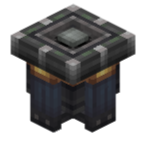

# Aero Bearing


> 1.0.9 added

The **Aero Bearing** is a Create kinetic block paired with a Sable physics body. Power enters through the **half-shaft on the back face** (axial input, like `create:mechanical_bearing`), and the assembled structure becomes an **independent physics body** (sub-level). The shaft is **through-going**: the input speed continues through the plate into the machinery inside the sub-level (input RPM = output RPM), but it does **not** drive the physical angle of the plate / sub-level.

## Drive policy

| Input | Behaviour |
|---|---|
| **Kinetic power with RPM** | Only two things: charges stress at impact **4.0** (same as `simulated:swivel_bearing`) and passes the speed/stress through the plate to the machinery inside the sub-level. **The plate does not rotate.** |
| **Physical angle** | Set **only** by Lua `setTargetAngle()`. The PD servo holds the plate / sub-level at that target angle (aerodynamic loads on the sail cannot move it). |

> Sequenced angle inputs (`create:sequenced_gearshift`, hand crank, valve handle with `TURN_ANGLE`) **no longer** turn the plate.

## Lua API

The peripheral type is `aero_bearing` (wrap by direction, e.g. `peripheral.wrap("right")`, or `peripheral.find("aero_bearing")`).

| Method | Description |
|---|---|
| `setTargetAngle(degrees)` | Absolute positioning of the plate / sub-level (the only source of angle). Requires assembly. `mainThread=true` |
| `getTargetAngle()` | Current target angle (degrees, server-authoritative) |
| `getTargetAngleRad()` | Current target angle (radians) |
| `isControlMode()` | Always `true` (the angle is always Lua-controlled) |
| `setControlMode(enabled)` | No-op kept for old scripts, always returns `true` (the "stress driven" mode is gone) |
| `isAssembled()` | Whether a sub-level has been assembled |
| `assemble()` | Assemble the structure into a sub-level; returns whether it succeeded |
| `disassemble()` | Disassemble the sub-level back into world blocks; returns whether it succeeded |

```lua
local b = peripheral.wrap("right")

-- Assemble the structure in front of the bearing (power may enter from the back,
-- but it will not rotate the plate)
print(b.assemble())            -- true if a structure was assembled

-- The angle can only come from Lua
b.setTargetAngle(90)           -- plate to 90°
b.setTargetAngle(-45)          -- rotate back

-- Query state
print(b.getTargetAngle())      -- -45.0
print(b.isControlMode())       -- true (always true)
```

## Differences from `simulated:swivel_bearing`

| | swivel_bearing | Aero Bearing |
|---|---|---|
| Power input | Cogwheel meshed from the side | **Direct axial input** — shaft/network connects straight to the bearing axis |
| Stress network | Through-shaft (stress passes through) | **Also through** — the plate is a member of the same kinetic network, so both RPM and stress pass into the sub-level machinery |
| Angle control | Via network speed (incl. sequenced inputs) | **Only via Lua `setTargetAngle`**: kinetic power merely charges and transmits stress; the plate does not rotate |
