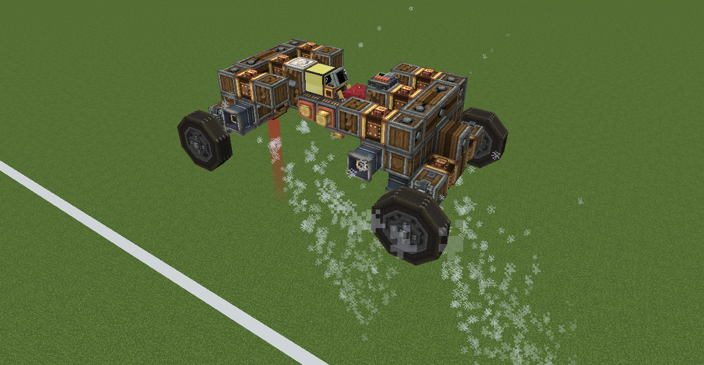

# Example - Tesla Roadster Flying Car



[Demo video](https://www.youtube.com/watch?v=HtjqcBWlACo)

[Save download](https://drive.google.com/file/d/1Wou3NvNSM9HFkKaXQhvy5Ir7vMfU_BC9/view?usp=sharing)

!!! tip "Note"
    Required mods:

    - CC Peripheral Extender 1.1.8+
    - CC:Tweaked
    - Create
    - Sable
    - Create: Aeronautics

## How to use: 
right-click the computer (the yellow block), click the second button in the top-left corner (or hold Ctrl+T for more than 1 second) to stop the currently running program, then type the following command:

```
autopilot track axis=z:-107.5
```

Autopilot mode is now enabled.

Control program location: `\New World (2)\computercraft\computer\3`
