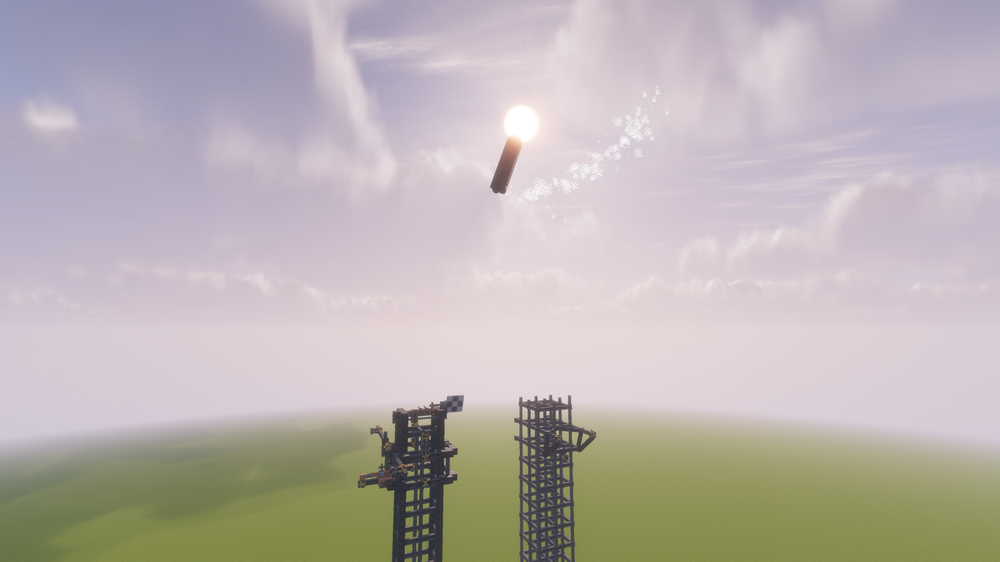

# Example - Starship Flight 15 Catch

> A complete CCPE flight-control showcase: a Starship Flight 15 replica (ship S42) is released belly-down near the build limit, free-falls, flips upright on five [vector nozzles](../actuators/advanced-thrust-nozzle.md), brakes, flies back to the tower and is caught by its arms — flown end to end by two CC:Tweaked computers talking over rednet.



## [> Download Save <](#)

<!-- TODO: replace "#" with the save download link -->

!!! tip "Note"
    Required mods:

    - CC Peripheral Extender (this mod)
    - CC:Tweaked
    - Create
    - Sable
    - Create: Aeronautics — includes Simulated, which provides the docking connectors
    - Create: Copycats+

## The mission in one table

`h` is height above the **catch point** `(11.50, 93.05, −0.49)` — `h = 0` means the vehicle is sitting inside the closed arms.

| # | Phase | Program | Measured on the final flight |
|---|---|---|---|
| 1 | Release & free fall | `flip dock` | 3.95 s / 76.5 m, `vy` −36.4 m/s |
| 2 | Flip back upright | `flip` | 1.90 s, horizontal speed 26.6 m/s, `cos` 0.996 |
| 3 | Reverse-thrust brake | `flip` | 5.1 s, lateral overshoot 10.2 m, ends ~23.5 m above the catch point |
| 4 | Guided return | `flip` | 8.4 s, ends 0.9 m from the target, altitude strictly monotonic |
| 5 | Dock request | `flip` → `catch` | sent **early**, 20 m above the catch point; arms need 5.3 s, lead is 7.40 s |
| 6 | Catch & lock | `catch` | `getConnectedName() ≠ ""` → `LOCK ok  ch8=[S42] ch9=[S42]` |
| 7 | Fuel connection | both | tower `ch7 = 15`, then ship `ch6 = 15` + `setStrongPower(6, true)` |
| 8 | Secured | `flip` | after 1.5 s with horizontal and vertical speed under 0.30 m/s the nozzles shut down |

The whole run is autonomous: one command on each computer and no player input.

`S42` in the lock line is the ship's physics-body name — that is why it appears on both arm channels.

## Hardware

### Ship (computer 0)

- **5 × vector nozzles** on encased fans — one on the centreline (`ch0`), four around it (`ch1`–`ch4`). This is the only actuator that produces thrust.
- **AIC** (aviation integrated computer) — one block that counts as both INS and FMC: attitude quaternion, angular velocity, mass and gravity. The local air pressure `p` comes from the same sensor system.
- **2 docking connectors on top** (`ch5`) as the main hold, **1 underneath** (`ch6`) for fuel; `ch6` is driven with `setStrongPower`.
- **Flight data recorder** — every flight writes a CSV to `/log/flip_*.csv`.

### Tower (computer 1)

- **2 catch arms** (`ch8` / `ch9`) that travel from ±90° to 0° at 2 rpm.
- **1 fuel port** (`ch7`) that is opened only after the lock is confirmed.
- The catch sequence stands by and waits for the ship's rednet request.

### Channel map

Channels are **physics-body scoped** and shared with the [short-range signal linkers](../sensor-system/short-range-linker.md); Lua reaches them through `ccpe.sensor_system.getPeripheral(ch)`. A docking connector reads as an ordinary peripheral once a linker is attached to it, so the ship's program finds it by probing neighbours first and then `getPeripheral(0..15)`.

| Channel | Side | Device | Notes |
|---|---|---|---|
| `ch0` | ship | centre nozzle | `setInverted(true)` — the only reversed nozzle |
| `ch1` / `ch3` | ship | nozzle pair A | torque about body **X** |
| `ch2` / `ch4` | ship | nozzle pair B | torque about body **Z** |
| `ch5` | ship | 2 top connectors | main hold; clearing both = release |
| `ch6` | ship | 1 bottom connector | fuel; `setStrongPower(6, true)` |
| `ch7` | tower | fuel port | opened after lock only |
| `ch8` / `ch9` | tower | catch arms | the lock probe reads **only** these two |

!!! warning "One lock probe rule"
    Scanning channels 0–15 for the lock hits the fuel port (`ch7`) too, and the fuel port is deliberately *not* powered while waiting — the probe then reports "not detected" forever. Probe `ch8` / `ch9` exclusively.

## Three control laws worth copying

All three are plain Lua at **20 Hz**; every cycle ends in a single `parallel.waitForAll` write block.

```lua
-- 1. vertical: target height -> target vertical speed -> desired acceleration -> throttle
vyRef = clamp(K_POS * (hTarget - h), -VY_HOVER, VY_HOVER)   -- K_POS 0.9, VY_HOVER 3
aDes  = clamp(KV * (vyRef - vy), -A_ACC, A_BRK_MAX)          -- KV 6, A_ACC 6, A_BRK 5
u     = clamp(m * (G + aDes) / cosVert / Fmax, 0, 1)         -- Fmax = N * 256 * 2.05 * p
if cosVert < COS_MIN then u = 0 end                          -- COS_MIN 0.25
```

```lua
-- 2. attitude: quaternion PD that pulls the body's up axis onto the commanded direction
n_w = up:Cross(uCmd)                    -- world rotation axis
e   = math.acos(up:Dot(uCmd))           -- n_b = R^-1 * n_w  ->  e_x, e_z (rad)
a_x = KP * e_x - KD * w_x               -- KP 3.0, KD 2.5
a_z = KP * e_z - KD * w_z
room = math.min(0.33, u - 0.02, 1 - u)  -- differential headroom left by thrust
D_A = clamp(a_x / GAINX, -room, room)   -- GAINX -1.0  (pair A -> body X)
D_B = clamp(a_z / GAINZ, -room, room)   -- GAINZ +1.0  (pair B -> body Z)
-- each pair sums to 2u, so the net vertical thrust does not change:
ch1 = u + D_A;  ch3 = u - D_A
ch2 = u + D_B;  ch4 = u - D_B
```

```lua
-- 3. lateral: position -> velocity -> acceleration -> tilt
vTarget = clamp(LAT_KP * posErr, -LAT_VMAX, LAT_VMAX)       -- 0.30 / 1.2
aDes    = clamp(LAT_KV * (vTarget - vHoriz), -LAT_AMAX, LAT_AMAX)  -- 1.00 / 2.0
theta   = math.atan(math.abs(aDes) / G)                       -- capped at 18 deg
uCmd    = normalize(cos(theta) * up + sin(theta) * aDesDir)
```

Three facts behind them, each learned by crashing:

1. **Tilt direction = thrust direction = drift direction.** To accelerate, lean that way; to brake, lean against the velocity.
2. **Tilt is a slow actuator** — 18° takes ≈1.3 s, so the lateral loop bandwidth must stay well below 0.7 rad/s.
3. **Never pull sideways with tilt before there is an attitude loop.** Without one it is positive feedback, and the vehicle rolls over (0.06 cosVert).

## The flip is done by the nozzle cone, not by differential thrust

Differential thrust has a hard ceiling: `α = 1.0 rad/s²` per unit `D`, and `room` caps `D` at ~0.33 while hovering → **0.33 rad/s²**. A 90° flip then costs `2√(θ/α) ≈ 4.3 s` and ~100 m of fall; with a rate loop attached it is >5.4 s and needs 250–300 m. That is not a flip, it is a fall.

Tilting the vector nozzles is different, because **tilting thrust also tilts the torque**: at full 15° deflection and full thrust the measured authority is **α ≈ 2.5 rad/s²**, with a peak of **7.3 rad/s (418°/s)** — 90° in **~1.2 s**, dropping only ~55 m. That is **7–8×** the differential authority, and it is the reason "flip while falling back" became possible at all.

Consequences:

- **Cone torque scales with geometric thrust**: `α_available ≈ α_full × u`. Using `α_full` in the loop denominator at `u = 0.45` makes the loop believe it has 2.2× the torque it really has → guaranteed saturation and overshoot. Both the cone loop and the brake curve `√(2·α·|e|)` must use `α_full × u`.
- **Cone and differential cannot run in parallel.** Differential headroom is `min(0.33, u−0.02, 1−u)`; at `u = 1` there is none, and dropping to `u ≤ 0.67` to make room also drops cone torque to 67%. Time-share instead: the cone does the large rotations, differential holds and trims attitude once `u` is low.
- The cone's slew is 160°/s and its output scale ramps at 0.25/tick, so 15° is ≈2 ticks away — fast, but not instantaneous.

## Terminal approach: no hovering over the pad

Early versions aligned above the target, hovered, then slid across — and the vehicle oscillated (3.6 s of hovering with `vy` reversing 6 times). The accepted approach is a **continuous diagonal descent**:

- **Clearance is proportional to lateral error**: `hTgt = capH + apClearK × perr` (`apClearK = 0.35`), with a ratchet on the lowest height reached, so the target can only ever go down — never up.
- **The vertical profile is the smaller of three curves**: `vyRef = min(vyCap, √(2·apVySqrtA·|dh|), apLinK·|dh|)`. The linear term (`2.0`) takes over below ~1.5 m, where the square-root curve would command 1.7 m/s for a 0.5 m error and start oscillating.
- **The horizontal speed follows a braking curve that hits zero at the capture radius**: `vTarget = min(apVmax, √(2·apBrakeLat·max(perr − apCaptureR, 0)))` with `apVmax 2.2`, `apBrakeLat 2.0`, `apCaptureR 1.0`. Without the `− apCaptureR` offset the ship arrives at 2 m/s and has to come back.
- **Gains stay under the actuator limit**: `apKP 0.30 / apKV 0.85` give a closed-loop `√(KP·KV) ≈ 0.50 rad/s`, below the ~0.7 rad/s set by the 1.3 s tilt actuator.
- **The last 1–2 m are left to the docking connector's suction.** The pass criterion is 5 m, so an error around 1 m is normal — chasing zero error only produces limit cycles.
- **A stall valve, not a stopwatch.** The commit timeout is only armed when `h` has not improved by `apStallEps = 0.20 m`; a fixed 4 s timer fires in the middle of a perfectly healthy descent and flattens the last few metres into a sideways slide at pad height.

## Constants worth trusting

Every number below was measured on the actual build; none of them should be re-derived from intuition.

| Quantity | Value |
|---|---|
| Gravity | **11 m/s²** |
| Thrust | `F = N × 256 × 2.05 × p × scale` (2.05 pN/RPM measured, 2.0 nominal) |
| Dry mass | **61 kg** (219 kg when the chain is clamped) |
| TWR at full throttle | 3.44–3.55 at the platform (`p ≈ 0.887`), ≈2.26 in the cloud layer (`p ≈ 0.58`) |
| Hover throttle | **0.284** with 5 nozzles, **0.35** with 4 |
| Differential authority | **1.0 rad/s² per unit D**, 0.15 s step lag |
| Inertia / thrust arm | `I ≈ 15.9 kg·m²`, `r ≈ 1.0 m` |
| Control rate | **20 Hz**, exactly one `parallel.waitForAll` write block per cycle |
| Universal drag | `F = −m·0.09·v` — deceleration `0.09·v`, independent of mass |
| Terminal velocity | `G/d ≈ 122 m/s` (never reached inside these altitudes) |

Two consequences of the drag model matter for the profile: velocity decays with a time constant of ~11 s, so **lateral drift and residual spin do not bleed off by themselves** — they must be actively braked; and a fall of 150 m only reaches ~48 m/s, not terminal.

## Traps that cost flights

| Trap | Lesson |
|---|---|
| Commanding a 90° attitude error at once | At `θ ≈ 90°` the `(e_x, e_z)` signs flip, so the controller drives the wrong way. Use staged targets ≤ 30–36° and re-check the sign every stage. |
| Using the nozzle cone for lateral translation | The same channel delivers force **and** torque → pitch positive feedback, `cosVert 0.06`, roll-over. |
| Using "higher release" as extra margin | Thrust ∝ pressure, so 10 m higher costs the flip leg ~8.5 m more fall. Only ~1.5 m of the 10 m is recovered. Buy margin with authority, not altitude. |
| Writing connectors / redstone one by one | Each write takes ~1 tick; the body tilts a little between writes and the thrust leaks sideways. One parallel block per cycle. |
| Trusting the program's own printouts | Measured values printed by the program were repeatedly wrong; the CSV replay was right. `getRotationSpeed()` in particular reports the configured speed, not the actual one. |
| Tuning the brake constant by feel | Overshoot is `vh²/(2·a_eff)` with `a_eff ≈ 2.7 + 1.0·dockBrakeAMax`; 1.5 → 24.4 m, 2.0 → 9.8 m, 2.2 → 4.6 m. Change it ≤0.3 at a time and check the entry speed first. |
| Passing arguments as `args` | CC:T passes program arguments as varargs. `args` is a legacy global that is `nil` here, so `flip fock` silently ran the default branch, dropped the ship and crashed it. Parse `{ ... }`. |
| Keeping old script versions on the computer | CC:T disks hold 1 MB. With 544 KB of old versions the free space fell below the program's 120 KB safety margin and the CSV recorder was **silently skipped** — the whole flight had no data. |
| Stopping the program when it looks done | The CSV only closes at the end. Stopping early leaves a 0-byte file. |

## Flying it yourself

1. Load the save and let the world settle: the ship hangs from its top connectors, the tower arms are at rest.
2. The **tower** computer (computer 1) needs no command. Its `startup.lua` clears the arm and fuel connectors, waits 1 s and then runs `catch` by itself, so the arms reset and wait for a request.
3. **To disconnect the arms from the ship** — or to reset between runs — restart the tower computer: the first second of its startup drops both arm connectors and the fuel port.
4. On the **ship** computer (computer 0) run `flip dock`. Its startup has already powered the engine, straightened the nozzles and clamped both connectors; the program then cuts them, falls, flips, brakes, returns, requests the dock, receives the lock reply, fuels and shuts down.
5. Do not stop either program while it runs — wait for `VERDICT PASS` on the ship side.

Key lines to watch:

| Line | Meaning |
|---|---|
| `PROBE ... arm channels 8/9` | tower sees its arms |
| `CATCH request (early: h=+20 ...)` | ship asked for the catch at 20 m, arms start moving |
| `LOCK ok  ch8=[S42] ch9=[S42]` | both arm connectors are connected — the ship is held |
| `FUEL` | fuel port powered on both sides |
| `VERDICT PASS` / `SECURED` | ship-side summary and final shutdown |

## Programs in the save

| Program | Computer | Role |
|---|---|---|
| `flip.lua` (**v44**) | 0 | flight: release → fall → flip → brake → return → dock request → fuel handshake → shutdown |
| `catch.lua` (**v1.6**) | 1 | tower: reset arms → wait for request → close arms → lock check → fuel → reply |
| `startup.lua` | 0 / 1 | boot: the ship powers the engine, straightens the nozzles and clamps both connectors; the tower drops the arm + fuel connectors for 1 s, then runs `catch` |
| `probe.lua`, `cal1.lua`, `att.lua`, `tilt.lua`, `guide.lua`, `thruststress.lua` | 0 | one-shot calibrations and diagnostics used while developing the control loops |

## Related pages

- [Advanced Thrust Nozzle](../actuators/advanced-thrust-nozzle.md) — the only actuator on the ship
- [Aviation Integrated Computer](../sensor-system/aic.md) — the ship's INS + FMC in one block
- [Short-Range Signal Linker](../sensor-system/short-range-linker.md) — physics-body channels
- [Flight Data Recorder](../sensor-system/flight-data-recorder.md) — the CSV behind every number here
- [Aeronautics Sensor Integration](../peripheral-extender/simulated-integration.md) — reading Simulated docking connectors
- [Aerodynamics: Real vs Game](aerodynamics.md) — why the drag model behaves the way it does
