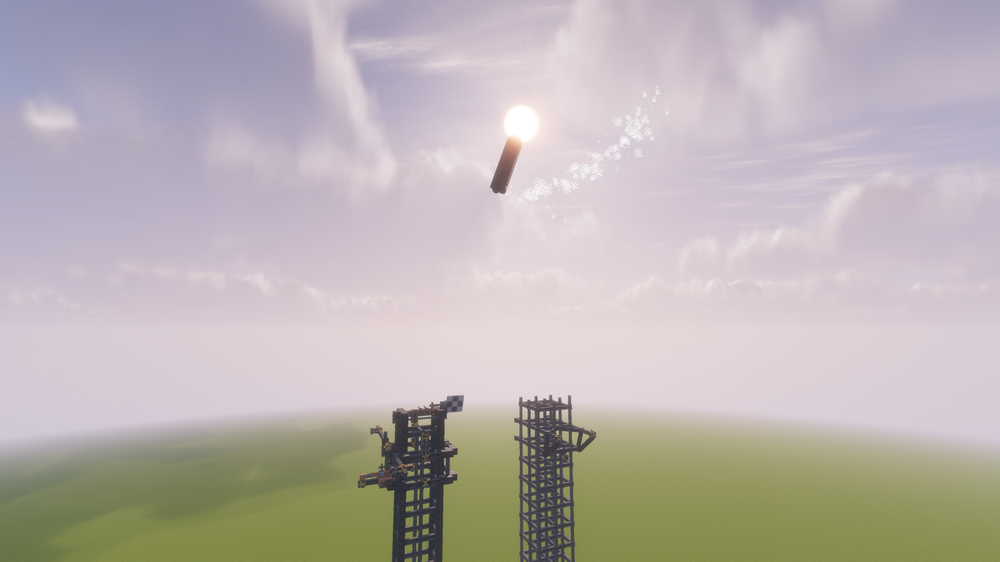

# 示例 - 星舰 Flight 15 夹取回收

> 一个完整的 CCPE 飞控展示：星舰 Flight 15（S42）以腹部朝下的姿态在接近建造高度上限处投放，自由落体、靠五台[矢量喷管](../actuators/advanced-thrust-nozzle.zh.md)回翻、反推刹车、飞回塔架，最后被夹臂夹住——全程由两台通过 rednet 通信的 CC:T 电脑完成，不需要玩家操作。

## [> 存档下载 <](#)

<!-- TODO: 存档下载链接占位，替换 "#" 为实际链接 -->

!!! tip "说明"
    需求模组：

    - CC Peripheral Extender（本模组）
    - CC:Tweaked
    - Create
    - Sable
    - Create: Aeronautics（内含 Simulated，提供对接连接器）
    - Create: Copycats+

## 自己飞一遍

1. 载入存档，等世界稳定：飞行器吊在顶部连接器上，塔架夹臂处于复位状态。
2. 在**船体**电脑（电脑 0）执行 `flip dock`。它的 startup 已经启动引擎、把喷管打直并夹紧两条连接器；程序随后切断它们，自由落体、回翻、刹车、回程、请求夹取、收到锁定回执后加油并关喷口。
3. **塔架**电脑（电脑 1）不需要敲命令。它的 `startup.lua` 会先把臂与加油口的连接器清零、等 1 s，然后自动执行 `catch`，夹臂复位并等待请求。
4. **要让夹臂与飞船断开**（或每轮之间复位），重启塔架电脑即可——startup 的头一秒会把两条臂连接器和加油口一起断开。

## 设计文档
https://github.com/ZombieEggStew/ccnavigationtable-template-1.21.1/blob/main/memo/flight/starship15-catch.md

## 存档里的程序

| 程序 | 电脑 | 作用 |
|---|---|---|
| `flip.lua`（**v44**） | 0 | 飞行：脱落 → 自由落体 → 回翻 → 刹车 → 回程 → 请求夹取 → 加油握手 → 关喷口 |
| `catch.lua`（**v1.6**） | 1 | 塔架：复位夹臂 → 等请求 → 合臂 → 锁定判定 → 加油 → 回执 |
| `startup.lua` | 0 / 1 | 开机：船上启动引擎、打直喷管并夹紧两条连接器；塔架先把臂与加油口断电 1 s，然后执行 `catch` |
| `probe.lua`、`cal1.lua`、`att.lua`、`tilt.lua`、`guide.lua`、`thruststress.lua` | 0 | 调试控制环时用的一次性标定与诊断程序 |

## 相关页面

- [矢量喷管](../actuators/advanced-thrust-nozzle.zh.md)——船上唯一的执行器
- [航空集成计算机](../sensor-system/aic.zh.md)——一块方块同时充当 INS 与 FMC
- [短程信号链接器](../sensor-system/short-range-linker.zh.md)——按物理体分配频道
- [飞行数据记录系统](../sensor-system/flight-data-recorder.zh.md)——本文所有数字的来源
- [航空学传感器集成](../peripheral-extender/simulated-integration.zh.md)——读取 Simulated 的对接连接器
- [气动模型：游戏 vs 现实](aerodynamics.zh.md)——阻力模型为什么是这个行为
